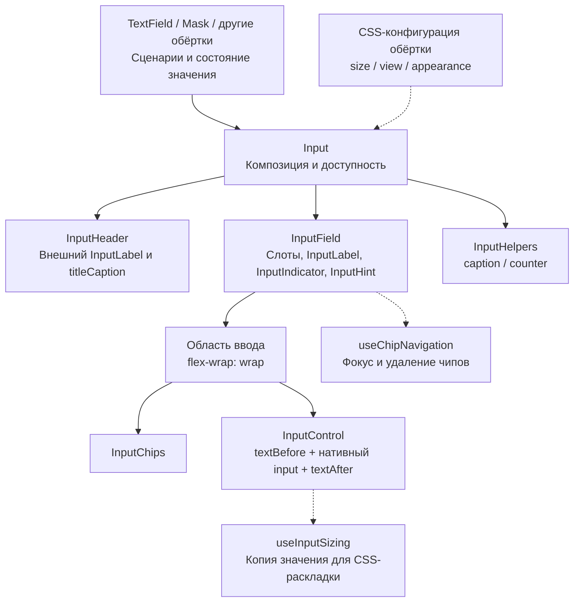

# ADR 0001: Input как композиционная основа полей ввода

-   **Дата фиксации:** 2026-11-19.
-   **Статус:** предложено к принятию через ревью PR.
-   **Область решения:** базовый Input в `plasma-new-hope` и компоненты, которые используют его как поле ввода.

## Контекст

[Прежний TextField](../../../../TextField/TextField.tsx) объединяет отрисовку поля, оформление,
состояние чипов, их создание и удаление, проверки ввода и сценарии поиска. Обработка событий
связана с режимами этого компонента. Использование TextField как основы для маски или другого
поля переносит в новый компонент лишние зависимости и требует согласовывать его поведение
с уже существующей логикой TextField.

Нужна общая UI-основа для TextField, Mask и других полей. Она должна обеспечивать одинаковую
разметку, доступность и взаимодействие с оболочкой, позволяя каждому потребителю независимо
управлять значением и правилами ввода. Разделение затрагивает несколько компонентов и их
CSS-конфигурации, поэтому фиксируется как архитектурное решение.

При переполнении чипы должны переноситься на новые строки, как в
[Mantine TagsInput](https://mantine.dev/core/tags-input/), увеличивая высоту поля.
Место для ввода остаётся после последнего чипа, а прокрутка текста не должна сдвигать чипы.

## Решение

Выделить [Input](../../Input.tsx) в самостоятельный базовый компонент со следующими границами:

1. **Сценарии остаются у потребителя.** Маскирование, преобразование и прикладная валидация значения,
   поиск, создание чипов и изменение их списка реализуются в обёртках. Input получает данные
   и сообщает о действиях через обработчики. Он сохраняет нативные `value` / `defaultValue`,
   атрибуты и ref на HTML-поле.
2. **Общая UI-механика входит в Input.** Композиция подписей, подсказок и индикаторов,
   связи доступности, фокус, навигация по чипам и прокрутка принадлежат базовому компоненту.
   Отсутствие сценарной логики не означает отсутствие интерактивности.
3. **Разметка собирается из внутренних UI-компонентов.** `Input` связывает части через props
   и refs; хуки отвечают за взаимодействие. Потребители используют
   API Input и его CSS-контракт, а не дублируют внутреннюю сборку поля.
4. **Оформление отделено от сценариев.** Стили определяются CSS Modules, CSS-переменными
   и статическими классами. Варианты `size`, `view`, `appearance` задаёт конфигурирующая обёртка,
   как в [примере Input](../../../../../examples/components/_beta/Input/Input.tsx).
   Базовый компонент не использует прежний engine конфигурации компонентов.
5. **Чипы переносятся, текст прокручивается нативно.** Чипы и группа ввода с аффиксами
   располагаются в общем flex-контейнере с `flex-wrap: wrap`. Группа ввода сохраняет минимальную
   ширину из CSS-конфигурации и растёт по ширине значения с аффиксами. Если группа перестаёт
   помещаться рядом с чипами, она переходит на следующую строку и занимает свободное место;
   при сокращении значения может вернуться к чипам. Ширина ограничена шириной контейнера.
   Длинный чип ограничен шириной контейнера:
   текст обрезается троеточием, кнопка удаления остаётся доступной. Перенос работает одинаково
   при фокусе, вне фокуса, в `disabled` и `readOnly`. Нативный input обеспечивает прокрутку
   значения и видимость каретки; вне фокуса показывается начало значения с троеточием
   при переполнении. Скрытая копия значения задаёт предпочтительную ширину группы средствами CSS;
   JavaScript синхронизирует её с нативным значением после ввода, обновления props и сброса формы.
   Вычисления геометрии и положения каретки, общая горизонтальная прокрутка не требуются.

### Почему отказались от прежнего engine

[Engine](../../../../../engines/common.tsx) предоставляет общий механизм слияния конфигураций,
вариантов, значений по умолчанию и сборки компонента через CSS-in-JS. В прежнем TextField
оформление проходит через цепочку `mergeConfig` → `component` → адаптер библиотеки стилей.
Чтобы изменить или отладить оформление, нужно учитывать правила этих слоёв.

Для базового Input достаточно фиксированной разметки и CSS-контракта: размеры и виды задаются
переменными, состояния — селекторами, а конфигурирующая обёртка выбирает классы вариантов.
Поэтому универсальную фабрику компонентов заменяем обычным React-компонентом и CSS Modules:

-   Убираем из сборки Input слой слияния конфигураций и вычисления стилей через engine.
    CSS извлекается при сборке и применяется браузером.
-   Сохраняем одну CSS-реализацию основы, не привязанную к адаптерам `styled-components`,
    Emotion или Linaria. Оформление обёртки подключается через переменные и классы.
-   Делаем связь между конфигурацией и результатом явной: выбранный класс задаёт переменные,
    внутренние элементы используют их в CSS. Это упрощает поиск источника стиля и ревью изменений.

Цена решения — отказ от автоматической сборки через прежние объекты конфигурации.
Типы вариантов, их значения по умолчанию и выбор классов теперь явно задаёт конфигурирующая
обёртка; существующие engine-конфигурации при миграции нужно переносить на CSS-контракт Input.

## Отличия от прежнего TextField

| Аспект                | Прежний TextField                                                           | Базовый Input                                                       |
| --------------------- | --------------------------------------------------------------------------- | ------------------------------------------------------------------- |
| Ответственность       | UI и сценарии поля связаны в одном компоненте                               | Общий UI отделён от сценарных обёрток                               |
| Чипы                  | Создаёт и хранит внутренний список в режиме перечисления                    | Отображает переданный список и вызывает обработчик удаления         |
| Оформление            | `styled-components`, engine-конфигурация и variations                       | CSS Modules и внешние CSS-конфигурации                              |
| Раскладка и прокрутка | Текст прокручивается внутри input, чипы показываются через `scrollIntoView` | Чипы переносятся на новые строки, текст прокручивается внутри input |

## Схема композиции

Сплошные стрелки показывают композицию, пунктирные — зависимости от оформления и UI-механики.
Слой TextField / Mask обозначает выбранное направление переиспользования; миграция существующих
реализаций выполняется отдельно.

## Рассмотренные альтернативы

-   **Продолжать использовать TextField как базу.** Сохраняет существующие связи между UI,
    состоянием чипов и сценариями; новые поля вынуждены учитывать чужие режимы и обработчики.
-   **Ограничить основу одним HTML-input.** Оставляет подписям, подсказкам, чипам и фокусу
    отдельную реализацию в каждом поле, увеличивая расхождения между компонентами.
-   **Общая горизонтальная прокрутка чипов и текста.** Скрывает часть чипов и требует
    измерять текст и каретку, синхронизировать прокрутку после ввода, изменения размеров
    и загрузки шрифтов. Не соответствует требованию переноса чипов на новые строки.

## Последствия

-   Общая разметка, доступность и клавиатурное взаимодействие исправляются в одном месте.
    Сценарии маски, поиска и валидации можно развивать независимо от оболочки.
-   UI-слой управляет фокусом и клавиатурной навигацией по чипам. Раскладку обеспечивает CSS,
    прокрутку текста — нативный input, без вычисления положения каретки и синхронизации скролла.
-   Высота поля зависит от числа строк чипов; окружающая форма должна допускать её изменение.
    Боковые слоты остаются вне области переноса, подписи и вспомогательный текст сохраняют
    свою композицию.
-   Обёртки должны адаптировать свои сценарии и оформление к API Input. Переход существующих
    полей выполняется постепенно с сохранением их публичных контрактов.

После принятия запись сохраняет зафиксированное решение. Пересмотр границ ответственности,
композиции или способа конфигурации оформляется новым ADR со ссылкой на заменяемую запись.
Детали API и текущие алгоритмы документируются отдельно.
