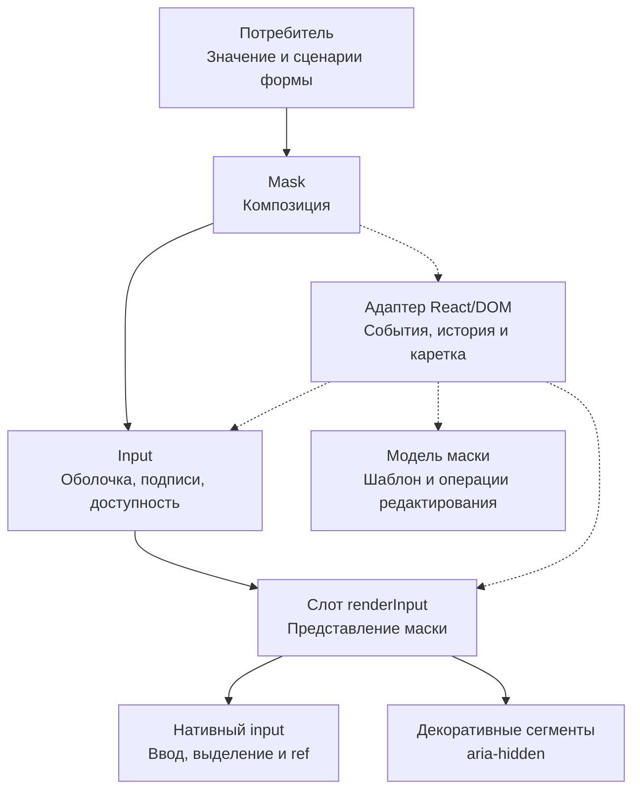

# ADR 0001: Собственный движок Mask поверх базового Input

-   **Дата предложения:** 2026-11-20.
-   **Статус:** предложено к принятию через ревью PR.
-   **Область решения:** движок маски, модель значения и композиция beta Mask с Input.

## Контекст

[Прежняя Mask](../../../../Mask/Mask.tsx) создаёт компонент через `composeMask(InputComponent)`
и передаёт форматирование и каретку в `@salutejs/react-maskinput`. Её публичные типы зависят
от `@salutejs/input-core`; ref нативного поля получается через адаптер `getReference`.
Изменение правил редактирования требует учитывать поведение внешнего движка и его обёртки.

Для новой Mask нужны ввод и удаление в середине значения, управление выделением и кареткой,
вставка, копирование, работа с мобильными клавиатурами. Введённые символы, разделители
и направляющая должны оформляться раздельно. Общую оболочку поля планируется переиспользовать
из beta Input согласно его [ADR 0001](../../../Input/docs/adr/0001-input-composition.md).

На первый этап ревью выносятся этот ADR и [публичные типы Mask](../../Mask.types.ts).
Реализация компонента и проверка поведения будут отдельным изменением после согласования
архитектуры и API. Имена и разбиение внутренних файлов этим решением не фиксируются.

## Предлагаемое решение

1. **Реализовать движок с нуля.** Правила маски и управление кареткой разместить в ядре Plasma,
   без зависимостей от `react-maskinput` и `input-core`. Разделить чистую модель редактирования,
   адаптер событий React/DOM и представление. Прикладную валидацию и сценарии формы оставить
   потребителю.
2. **Хранить заполненность позиций явно.** Для режима шаблона каждая позиция должна содержать
   введённый символ или признак отсутствия значения. Из этой модели формировать строки
   и сегменты значения, разделителей и направляющей. Восстановление заполненности только
   по видимой строке недопустимо: введённый ноль и нулевая направляющая должны различаться.
3. **Объединить источники редактирования.** Клавиатурный ввод, вставку, вырезание и нативные
   изменения направлять в общие операции движка. Адаптер должен согласовывать управляемое
   и неуправляемое значение, историю и каретку после обновления DOM. Предусмотреть нативные
   события ввода для мобильных клавиатур и автозаполнения.
4. **Использовать Input как UI-основу.** Подписи, подсказки, аффиксы, состояния оболочки
   и их связи доступности оставить в Input. Интеграцию представления маски предусмотреть
   через слот `renderInput`, передающий нативные свойства, обработчики и ref.
   Правила шаблона и допустимые позиции каретки должны принадлежать Mask.
5. **Сохранить один нативный input.** Он должен обеспечивать ввод, фокус, выделение,
   копирование и ref потребителя. Для режима шаблона предусмотреть декоративный слой
   сегментов поверх прозрачного текста поля, синхронизированный с его прокруткой.
   Слой должен иметь `aria-hidden` и не перехватывать указатель. Оформление задавать
   через CSS Modules и CSS-переменные, согласованные с конфигурацией Input.

### Публичный контракт

Настройки объединить в `mask`: строка задаёт стандартный шаблон, объект — `pattern`, `guide`,
`visibility`, `definitions` и `showPrefix`. Для нестандартных правил предусмотреть альтернативный
режим `mask.format` со строковыми входом и результатом. Типами запретить сочетание форматтера
с настройками шаблона. Подробный контракт описан в `Mask.types.ts` и рассматривается вместе с ADR.

`value` и `defaultValue` должны принимать исходную или форматированную строку.
В `onValueChange` передавать `value` без незаполненного окончания и `maskedValue` с полной
направляющей. Сохранить обработчики нативного поля и ref на `HTMLInputElement`.

Совместимость с API прежней Mask не является требованием первой beta-версии. Объект `mask`
позволит отделить настройки движка от свойств Input, а единый `visibility` — избежать
противоречивых флагов видимости. Пользовательские правила предлагается задавать словарём
`definitions`, без структур символов из `input-core`.

### Почему собственный движок

Переиспользование прежнего движка оставило бы правила редактирования и управление кареткой
за внешней абстракцией. Для новых требований нужно согласованно управлять моделью позиций,
выделением, копированием и визуальными сегментами. Собственная модель с явными переходами
позволит проверять алгоритмы отдельно от браузера и развивать их независимо от Input.
Цена решения — самостоятельная поддержка движка и различий браузерного ввода.

## Отличия от прежней Mask

| Аспект        | Прежняя Mask                             | Предлагаемая Mask                           |
| ------------- | ---------------------------------------- | ------------------------------------------- |
| Композиция    | `composeMask` над переданным компонентом | Компонент поверх beta Input                 |
| Настройки     | Независимые пропсы и контракт `reformat` | Объект `mask` и строковый форматтер         |
| Движок и типы | `react-maskinput`, типы `input-core`     | Собственная модель и адаптер событий        |
| Представление | Определяется движком и переданным полем  | Один нативный input и декоративные сегменты |

## Планируемая композиция

Сплошные стрелки обозначают композицию, пунктирные — передачу состояния и обработчиков.
Схема задаёт границы ответственности, а не конкретные внутренние модули.

## Рассмотренные альтернативы

-   **Адаптировать `react-maskinput`.** Позволит переиспользовать существующие алгоритмы,
    но потребует согласования состояния внешнего движка с новыми правилами и сегментами.
-   **Встроить маскирование в Input.** Свяжет общую оболочку с конкретными правилами ввода
    и усложнит её переиспользование для других полей.
-   **Использовать второй input или `contenteditable` для направляющей.** Потребует отдельно
    согласовывать фокус, выделение и доступность с нативным полем формы.

## Ожидаемые последствия

-   Правила маски можно будет развивать независимо от общей разметки Input. Чистая модель
    позволит проверять переходы без DOM; события, каретка, буфер обмена потребуют
    браузерных тестов. Проверки должны войти в этап реализации.
-   Управление кареткой потребует Selection API. Предлагаемый контракт ограничивает `type`
    значениями `text`, `tel`, `search`, `url`; цифровую клавиатуру следует задавать через `inputMode`.

После принятия запись сохранит зафиксированное решение. Пересмотр движка, модели значения
или границ композиции следует оформлять новым ADR со ссылкой на эту запись.
