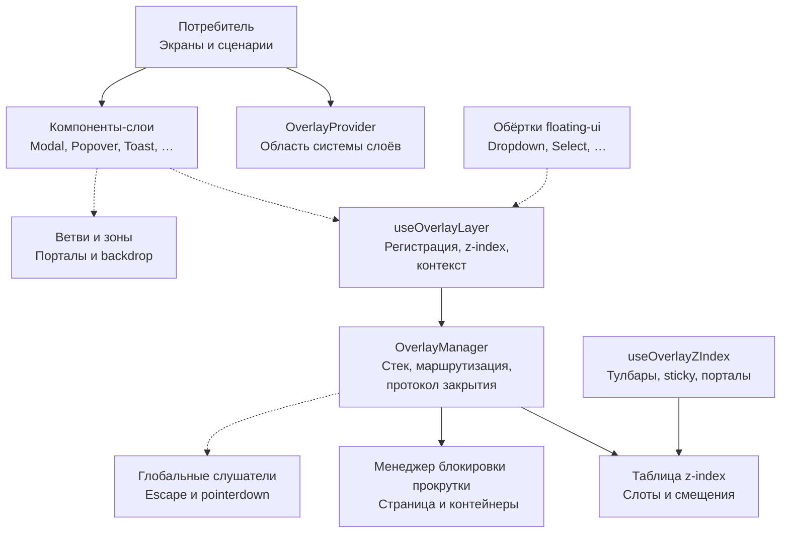

# ADR 0001: Единый стек слоёв Overlay для всплывающих компонентов

-   **Дата предложения:** 2026-11-25.
-   **Статус:** предложено к принятию через ревью PR.
-   **Область решения:** стек слоёв, маршрутизация Escape и кликов вне слоёв, распределение z-index, блокировка прокрутки, протокол запроса на закрытие.

## Контекст

Каждое семейство всплывающих компонентов ([Modal](../../../../Modal/Modal.tsx), [Popover](../../../../Popover/Popover.tsx), Tooltip, Toast, Notification) самостоятельно решает стекирование, Escape, клик вне слоя и блокировку прокрутки. Из-за этого одно нажатие Escape закрывает несколько слоёв сразу; Toast со слоем 9901 отображается над backdrop модалки; окно и backdrop Modal делят слой 9000, и с кастомным `zIndex` окно может оказаться под собственным backdrop'ом; обёртки floating-ui задают `zIndex || 1000` и отображаются под любой модалкой; блокировка прокрутки дублируется в Popup и Sheet; `FloatingPopover.tsx` скопирован в шести компонентах.

Понятия «верхний слой» в библиотеке нет, поэтому корректная маршрутизация закрытия невозможна. Требования зафиксированы в документах «Правила поведения группы Overlay» (§1–6) и «Overlay: возможности и гарантии SDDS» (G1–G8, close-request §6, матрица проверки OV-01…OV-10). На первый этап ревью выносятся этот ADR и контракт типов [OverlayProvider.types.ts](../../OverlayProvider.types.ts). Реализация компонентов и перевод вертикалей будут отдельными изменениями после согласования архитектуры.

## Предлагаемое решение

1. **Ввести единый менеджер слоёв.** [OverlayManager](../../OverlayManager.ts) — чистый TS-класс без React: упорядоченный стек по порядку регистрации, версия и подписка, регистрация и снятие слоёв. Менеджер один на приложение; провайдер и хуки получают его через контекст или глобальный синглтон.

2. **Классифицировать слои ролями.** Роль (`OverlayKind`): modal, drawer, bottom-sheet, tour, popover, dropdown, tooltip, toast, notification, toolbar, custom. Роль задаёт поведение по умолчанию и корневой слот z-index; поведенческих групп четыре: контейнерные роли по умолчанию модальны и вкладываются друг в друга; открытие модального режима закрывает временные роли (popover, dropdown, tooltip) с причиной `'internal'` (§2); роли-уведомления не перехватывают Escape (G2, G7); нейтральные роли (toolbar, custom) живут при открытой модалке. Внутри группы роли ведут себя одинаково и различаются только слотом z-index; роль перекрывается на месте через `mode` (модальный режим), поэтому жёсткой привязки роли к поведению нет.

3. **Маршрутизировать события только верхнему слою.** Один keydown на window и один pointerdown на document на всё приложение со счётчиком подключений. Escape получает верхний действующий слой и поглощает событие даже при `closeOnEsc=false` (§4). Клик вне слоя обходит стек сверху вниз: цель внутри слоя или его ветви — никто не закрывается; цель в зоне слоя (backdrop) — обрабатывает сам слой; иначе закрывается первый слой с `closeOnOutsideClick`.

4. **Принять протокол запроса на закрытие.** Библиотека предлагает закрытие с причиной (`escape`, `outside-click`, `owner-dispose`, `internal`); продукт в `onRequestClose` принимает, отклоняет (`preventDefault`) или откладывает его; `requestClose` возвращает результат (§6, OV-05).

5. **Централизовать z-index.** Корневой слот выбирается по роли: контейнеры — от 9000, уведомления и временные слои страницы — 8100/8200/8000, ниже backdrop модалки (§3). Вложенные слои отсчитываются от ближайшего слоя-предка: контейнеры `+100`, потребители `+50`; backdrop = слот `− 1`. Явный проп `zIndex` применяется как есть, дети отсчитываются от него. Компоненты не назначают z-index самостоятельно.

6. **Объединить блокировку прокрутки.** Менеджер сам блокирует страницу или контейнер со счетчиком, пока их удерживает хотя бы один слой, и восстанавливает прежний `overflow` (G6, OV-07).

7. **Подключать компоненты через `useOverlayLayer`.** Хук регистрирует слой на время открытия и возвращает вычисленный z-index, признак верхнего слоя, ref корневого узла и функции `registerBranch`, `registerZone`, `requestClose`. Потребителям, которым нужен только z-index, предусмотрен `useOverlayZIndex`.

8. **Учитывать порталы и зоны.** Обе регистрации отвечают на вопрос «чей это клик» при обходе стека. Ветвь (`registerBranch`) — узел в отдельном контейнере отрисовки (портале): DOM-проверка `contains` его не видит, поэтому он декларируется частью слоя и клик по нему считается кликом «внутри» слоя, а не снаружи (G3) — так триггер и отпорталенный список Select остаются одним слоем. Зона (`registerZone`) — территория при слое, не входящая в его узел (backdrop модалки, fade Toast): клик в зону останавливает обход стека и передаётся собственному обработчику слоя (`closeOnOverlayClick`), нижние слои не закрываются.

9. **Объявлять систему провайдером.** `OverlayProvider` достаточно смонтировать один раз в корне приложения: он подключает глобальные слушатели и передаёт контекст (владелец, слот z-index предка). Компоненты работают и без провайдера через глобальный менеджер; вложенные провайдеры не создают отдельного стека.

10. **Перевести семейство floating-ui на общую обёртку.** Dropdown, Select, Combobox, Autocomplete, DatePicker, TimePicker переходят с покомпонентных копий `FloatingPopover` на единую обёртку над `useOverlayLayer`: всплывающий список регистрируется слоем с ролью `dropdown`, триггер — ветвью, z-index берётся из таблицы. Устраняются `zIndex || 1000` и рассинхронизация закрытия с остальными слоями.

### Публичный контракт

Из ядра экспортируются провайдер и контекст, `useOverlayLayer`, `useOverlayZIndex`, менеджер с его синглтоном, таблица z-index с функциями расчёта и типы `OverlayKind`, `OverlayMode`, `OverlayCloseReason`, `OverlayCloseEvent`. Полный контракт приведён в [OverlayProvider.types.ts](../../OverlayProvider.types.ts).

Публичные пропсы компонентов (Modal, Drawer, Popover, Tooltip, Toast, Notification, Sheet, BottomSheet) и легаси-провайдеры (`PopupProvider`, `ToastProvider`, `NotificationsProvider`, `ModalsProvider` web/b2c) сохраняются: компоненты отображают их на хук внутри.

### Почему единый менеджер

Покомпонентные механизмы не дают ни маршрутизации «верхнему слою», ни детерминированного z-index. Аналоги сходятся к центральному распределителю z-index (Ant Design `useZIndex`) и центральному стеку закрытий с правом вето (Radix `DismissableLayer`), MUI добавляет счётчикную блокировку прокрутки, но ни одна библиотека не объединяет эти механизмы. Цена решения — самостоятельная поддержка менеджера и контракта «один document — один стек»: слои в iframe с собственной сборкой образуют отдельный стек, кросс-realm порталы не поддерживаются.

## Отличия от прежнего подхода

| Аспект               | Прежнее поведение                          | Предлагаемое поведение                                 |
| -------------------- | ------------------------------------------ | ------------------------------------------------------ |
| Стекирование         | константы в компонентах                    | таблица слотов по роли, пересчёт от предка             |
| Escape               | слушатель у каждого компонента             | маршрутизация верхнему слою, поглощение события        |
| Клик вне слоя        | проверки «внутри» на каждый компонент      | ветви и зоны, обход стека сверху вниз                  |
| Закрытие             | собственные колбэки                        | протокол с причиной и правом вето                      |
| Блокировка прокрутки | дубли в Popup и Sheet                      | общий счётчикный менеджер                              |
| Провайдеры           | на семейство компонентов                   | один OverlayProvider с fallback на глобальный менеджер |
| Дефолтные z-index    | Toast 9901, Tooltip 9200, BottomSheet 1000 | 8200, 8000, 9000 — по таблице слотов                   |

## Планируемая композиция

Схема задаёт границы ответственности, а не состав внутренних файлов.

## Рассмотренные альтернативы

-   **Оставить покомпонентные провайдеры и слушатели.** Не решает маршрутизацию закрытия, коллизии z-index и дубли блокировки прокрутки; каждое новое семейство компонентов воспроизводит те же проблемы.
-   **Перейти на CSS `top-layer` и Popover API.** Браузер даёт верхний слой без библиотеки, но ограничивает стилизацию, усложняет SSR и не покрывает протокол закрытия и z-index внутри документа.
-   **Собирать все слои в один корневой портал.** Ломает сценарии `frame`, `providerFrame` и inline-рендера, требует переписывать фокус и позиционирование.
-   **Взять готовые механизмы целиком** (`react-remove-scroll`, `DismissableLayer`). Покрывают часть задачи внешними зависимостями, но не дают распределителя z-index и единого протокола закрытия.

## Ожидаемые последствия

-   Порядок слоёв определяется порядком открытия, а не перерисовок: обработчики слоёв хранятся в ref, смена пропсов не переставляет стек.
-   Одно пользовательское действие закрывает не более одного компонента; дефолтные z-index меняются (Toast 9901→8200, Notification 9100→8100, Tooltip 9200→8000, BottomSheet 1000→9000) — потребуются миграционное примечание и re-baseline визуальных снимков.
-   Логика менеджера проверяется Node-тестами без браузера; события, порталы и блокировка прокрутки требуют браузерных тестов и должны войти в этап реализации.
-   Усиления доступности — `aria-hidden` соседям и владение focus-trap — выносятся в последующие ADR.

После принятия запись сохранит зафиксированное решение. Пересмотр стека, протокола закрытия или таблицы z-index следует оформлять новым ADR со ссылкой на эту запись.
