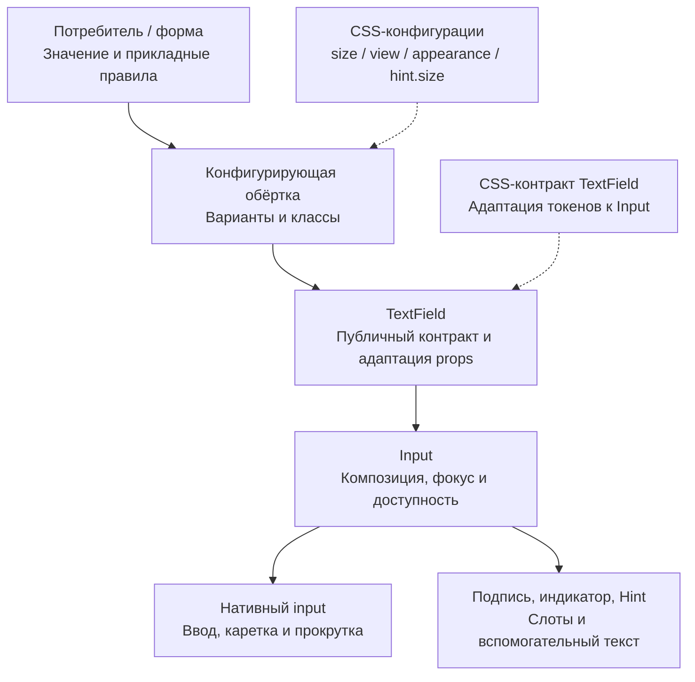

# ADR 0001: TextField как публичная обёртка над Input

-   **Дата фиксации:** 2026-11-26.
-   **Статус:** предложено к принятию через ревью PR.
-   **Область решения:** публичный TextField в beta ядра `plasma-new-hope`, его API и CSS-конфигурации.
-   **Связанное решение:** [ADR 0001: Input как композиционная основа полей ввода](../../../Input/docs/adr/0001-input-composition.md).

## Контекст

[Прежний TextField](../../../../TextField/TextField.tsx) объединяет разметку поля, оформление,
состояние чипов, режимы перечисления и обработку поиска. Его публичный контракт отражает эти
сценарии. Сохранение такого контракта в новом текстовом поле усложняет типы и связывает развитие
обычного ввода с логикой других компонентов.

Выделение [Input](../../../Input/Input.tsx) решает задачу общей UI-основы. Однако его API включает
возможности, необходимые разным обёрткам, в том числе отображение чипов и их клавиатурную
навигацию. Для потребителя текстового поля нужен отдельный контракт с понятными ограничениями
и без зависимости от внутренних вариантов сборки Input.

Граница между публичным полем, общей основой и конфигурацией оформления затрагивает API,
доступность и будущие подключения в вертикали, поэтому фиксируется отдельным решением.

## Решение

1. **TextField представляет публичный контракт текстового поля.** Реализовать его как обычный
   React-компонент, который адаптирует props к Input. Подпись задаётся строкой и отдельным
   `labelPlacement: outer | inner | none`. Публичные параметры индикатора преобразуются
   во внутренние свойства Input. API чипов и сценарии перечисления в TextField не включаются;
   ограничения поддерживаются типами и адаптацией props для потребителей JavaScript.
2. **Input отвечает за общую UI-механику.** Композиция частей поля, связи доступности,
   взаимодействие с оболочкой и нативная прокрутка переиспользуются из Input. TextField
   не собирает эти части повторно. Специализированные поля используют Input как основу
   и развиваются независимо от публичного контракта TextField.
3. **Значение и прикладные правила принадлежат потребителю.** Сохранить нативные
   `value / defaultValue / onChange`, атрибуты и ref на `HTMLInputElement`. Форматирование,
   маскирование, поиск и прикладная валидация остаются во внешних компонентах и формах.
   TextField не вводит собственную копию состояния значения.
4. **Оформление задаётся через CSS-контракт.** Использовать CSS Modules, статические классы
   и токены TextField, адаптированные к токенам Input. Конфигурирующая обёртка выбирает классы
   `size / view / appearance` и размера хинта. Размеры и типографика задаются в конфигурациях
   размеров, цвета и состояния — в конфигурациях видов, отдельно для каждого appearance.
   Каждый размер задаёт полный набор типографических свойств; размер хинта задаётся одним
   токеном `hintSize` из выбранного класса.

### Инварианты публичного контракта и доступность

-   `requiredIndicator` и `optionalText` — независимые необязательные свойства без union.
    При одновременной передаче `requiredIndicator=true` имеет приоритет, а `optionalText`
    скрывается. Индикатор обязательности сообщает состояние через `aria-required`, а нативный
    `required` отдельно управляет браузерной валидацией. Явные ARIA-атрибуты потребителя сохраняются.
-   При `labelPlacement=none` строка `label` может служить доступным именем поля. Связь
    видимой подписи с input и описаний с полем обеспечивает Input. Форма отвечает за
    содержательное имя, сообщения об ошибках и состояние прикладной валидации.
-   `readOnly` сохраняет нативную возможность фокуса, выделения и копирования значения;
    `disabled` использует нативное отключение поля.
-   `ref`, `className` и `style` TextField относятся к нативному input. Атрибуты, ref и
    конфигурационные классы внешнего контейнера передаются через `rootProps`.

### Почему сохраняем отдельную обёртку и отказываемся от прежнего engine

Публичный экспорт Input под именем TextField открыл бы потребителю внутренний API чипов,
подписей и индикаторов. Отдельная обёртка позволяет менять общую основу, сохраняя выбранный
контракт текстового поля. Цена адаптации ограничена преобразованием props и CSS-токенов.

Прежний engine объединяет конфигурации и адаптеры CSS-in-JS. Для выбранной композиции
достаточно фиксированной разметки и классов, задающих CSS-переменные. Как и в ADR Input,
принимаем явный выбор вариантов в конфигурирующей обёртке вместо универсальной фабрики.
Это сохраняет одну реализацию UI и делает источник оформления доступным для ревью.

## Отличия от прежнего TextField

| Аспект            | Прежний TextField                           | Новый TextField                          |
| ----------------- | ------------------------------------------- | ---------------------------------------- |
| Ответственность   | UI, чипы и сценарные обработчики объединены | Публичный контракт и адаптация к Input   |
| Переиспользование | Новое поле учитывает режимы TextField       | Общая основа — Input, обёртки независимы |
| API чипов         | Входит в контракт поля                      | Остаётся за границей TextField           |
| Оформление        | Engine-конфигурации и CSS-in-JS             | CSS Modules, токены и классы вариантов   |

## Схема композиции

Сплошные стрелки показывают композицию, пунктирные — зависимости от оформления.

## Рассмотренные альтернативы

-   **Расширять прежний TextField.** Сохраняет связанность сценариев и унаследованный API,
    ради устранения которых выделяется новая основа.
-   **Публично использовать Input напрямую.** Переносит его внутренние возможности в
    контракт текстового поля и заставляет потребителей учитывать лишние сочетания props.
-   **Реализовать поле отдельно от Input.** Дублирует композицию, фокус и доступность;
    исправления приходится согласовывать между несколькими реализациями.

## Последствия

-   Исправления общей UI-механики выполняются в Input; публичный API TextField развивается
    отдельно. Изменения основы требуют проверки поведения использующих её обёрток.
-   Конфигурирующие обёртки явно определяют варианты, значения по умолчанию и выбор классов.
    Адаптация публичных props и токенов требует сопровождения при расширении Input.
-   Новый контракт не обещает совместимости со всеми режимами прежнего TextField. Подключение
    в вертикали и миграция потребителей выполняются отдельно. Первое подключение ограничено
    точкой входа `/beta` ядра.

После принятия запись сохраняет зафиксированное решение. Пересмотр границ ответственности,
композиции или способа конфигурации оформляется новым ADR со ссылкой на эту запись.
