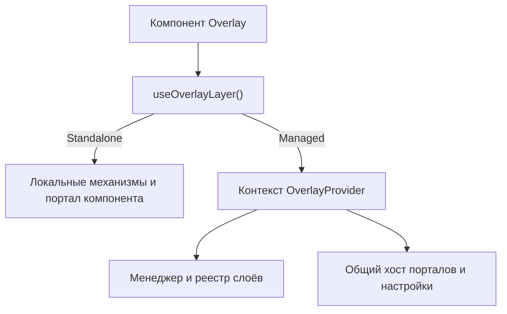

# ADR 0000: Архитектура группы Overlay и OverlayProvider

-   **Дата фиксации:** 2026-11-27.
-   **Статус:** предложено к принятию через ревью PR.
-   **Область решения:** бета-группа Overlay в `plasma-new-hope` — Modal, Drawer, BottomSheet,
    Popover, Dropdown, Select/ComboBox, Tooltip, Toast, Notification, плавающий ToolBar,
    общие механизмы координации и `OverlayProvider`.

## Кратко

-   В **Standalone** каждый компонент работает самостоятельно и поддерживает собственный портал.
    Продукт отвечает за совместную работу нескольких слоёв и может написать свой менеджер.
-   В **Managed** `OverlayProvider` оборачивает приложение, владеет стеком и общим хостом, передаёт
    настройки через контекст. Компонент провайдера входит в beta-поставку, подключение опционально.
-   Слой остаётся в стеке и DOM до завершения exit-анимации. Закрывающийся модальный слой сохраняет
    блокировку взаимодействия с фоном до передачи управления.
-   Managed-слои образуют цепочку владельцев. Escape и клик снаружи адресуются одному слою.
    Провайдер и компоненты реализуются поэтапно через общий внутренний контракт.

## Контекст

### Требования дизайна

Требования относятся к Web на desktop и mobile. Возможности и значения по умолчанию определяются
в контрактах компонентов. Дата инфраструктурного гайдлайна — 05.11.2026.
[Возможности и гарантии SDDS](https://www.figma.com/design/DVSySY0Kn8vBlCLeKQqBUF/Guidelines---Styles?node-id=1540-131&m=dev) ·
[Правила поведения Overlay](https://www.figma.com/design/DVSySY0Kn8vBlCLeKQqBUF/Guidelines---Styles?node-id=1470-1446&m=dev)

| Область                 | SDDS предоставляет                                                                                                        | Продукт определяет                                                                                |
| ----------------------- | ------------------------------------------------------------------------------------------------------------------------- | ------------------------------------------------------------------------------------------------- |
| Открытие и режим        | Управление видимостью, события жизненного цикла, поддерживаемые режимы, подложку и блокировку прокрутки                   | Причину открытия, модальность в доступных режимах и конфигурацию фона                             |
| Закрытие и фокус        | Запрос закрытия с причиной, возможность принять, отклонить или отложить его, установку и возврат фокуса с резервной целью | Условия выхода, подтверждение, сохранение данных, ожидание операции и цели фокуса                 |
| Композиция и размещение | Связь с владельцем, область отрисовки, привязку к источнику и поддерживаемые стратегии                                    | Какие слои сосуществуют, заменяют друг друга или открывают подзадачу, предпочтительное размещение |
| Сообщения               | Управляемый показ, действия, настраиваемое автозакрытие и объявление                                                      | Содержание, срочность, длительность, лимит, очередь и объединение повторов                        |

Модальность задаётся контрактом компонента. Modal модален, BottomSheet модален по умолчанию,
Drawer поддерживает оба режима. Popover, Dropdown, Tooltip, Toast, Notification и плавающий
ToolBar немодальны. В группе рассматриваются всплывающие списки Select и ComboBox.

В каждый момент активен один модальный сценарий. Вложенная модалка для подзадачи или подтверждения
сохраняет состояние родителя и временно блокирует его. При закрытии управление возвращается
родителю. Для последовательных шагов одной задачи дизайн рекомендует одно окно.

Гарантии инфраструктуры:

| ID  | Гарантия                                                                                                                                                                                                                 |
| --- | ------------------------------------------------------------------------------------------------------------------------------------------------------------------------------------------------------------------------ |
| G1  | В модальном режиме фон и предыдущие модальные слои недоступны для взаимодействия и вспомогательных технологий. Фокус ограничен верхним модальным слоем и его немодальными потомками.                                     |
| G2  | Локальная клавиатурная модель имеет приоритет. Обработанный или отклонённый Escape не закрывает предка. Отключение Escape у верхнего модального слоя не позволяет закрыть нижний.                                        |
| G3  | «Внутри / снаружи» учитывает дочерние слои, в том числе в отдельных контейнерах отрисовки; нажатие на блокирующую подложку не активирует фон.                                                                            |
| G4  | Цель фокуса доступна; при её потере используется резервный переход; закрытие немодального слоя не отнимает фокус у пользователя.                                                                                         |
| G5  | Завершение владельца деактивирует его дочерние слои и освобождает только принадлежащие ему ресурсы.                                                                                                                      |
| G6  | При включённой блокировке удерживается выбранная область, страница или контейнер. Внутренний скролл работает независимо. Блокировка снимается после последнего держателя с сохранением позиции фона.                     |
| G7  | Показ сообщения не перемещает фокус; действие доступно в активном контексте; нет дублирующих источников объявления; цвет не определяет срочность.                                                                        |
| G8  | Настройки сохраняют клавиатурное управление, видимый фокус и достижимость содержимого при масштабировании и экранной клавиатуре. При отключении одного способа выхода сохраняется доступный способ управления сценарием. |

Критерии приёмки применяются к каждой поддерживаемой конфигурации. Сценарии с несколькими слоями проверяются в Managed. Сценарии одного слоя проверяются и в Standalone, где возможность доступна.

| ID    | Конфигурация и действие                                          | Ожидаемый результат                                                                             |
| ----- | ---------------------------------------------------------------- | ----------------------------------------------------------------------------------------------- |
| OV-01 | Модальный Drawer; Tab / Shift+Tab.                               | Фокус остаётся в его контексте; фон недоступен.                                                 |
| OV-02 | Немодальный Drawer; Tab наружу.                                  | Фокус выходит из панели; фон остаётся доступным.                                                |
| OV-03 | Modal → меню; закрытие меню разрешено; Escape.                   | Закрывается меню; Modal не получает повторное событие.                                          |
| OV-04 | Закрытие снаружи включено / выключено.                           | Поведение соответствует настройке; дочерний слой — часть владельца; подложка не активирует фон. |
| OV-05 | Запрос закрытия отклонён / отложен.                              | Слой открыт; событие не закрывает предка; SDDS не повторяет внешнее действие.                   |
| OV-06 | Заданы цели фокуса; одна удалена.                                | Используются доступные цели и документированный резервный переход.                              |
| OV-07 | Два слоя блокируют страницу; скролл внутри, закрытие по очереди. | Внутренний скролл работает, фон неподвижен; блокировка снимается после последнего без скачка.   |
| OV-08 | Таймер уведомления задан / выключен.                             | Время жизни и паузы соответствуют настройкам; показ не меняет фокус.                            |
| OV-09 | Сообщение с действием показано в Modal.                          | Действие доступно с клавиатуры; нет дублирующих источников объявления.                          |
| OV-10 | Источник скрыт / удалён; изменён viewport.                       | Выполняется выбранная стратегия; нет оставшихся активных дочерних слоёв и потерянного фокуса.   |

### Текущее состояние

Компоненты группы уже существуют, но работают как независимые виджеты:

-   порядок задаётся разрозненными z-index: `9000` у окна и backdrop модалки, `9100` у
    Notification, `9200` у Tooltip, `9900/9901` у Toast, `1000` или ничего у всплывающих списков;
-   порталы собираются тремя механизмами: React-портал в узел `PopupProvider`, ручной
    `appendChild`, `FloatingPortal`;
-   каждый немодальный слой вешает собственный слушатель Escape и клика на `window`;
-   Escape модалок привязан к `PopupProvider`; без провайдера координации нет;
-   блокировка прокрутки ставится на `body.overflowY` без компенсации скроллбара;
-   фокус живёт в отдельных компонентах фрагментарно; `inert`/`aria-hidden` зоны нет;
-   причина закрытия не передаётся системно, вето возможно только синхронно.

### Область действия гарантий

Обе ноды Figma описывают поведение слоёв и требования к веб-доступности. Выбор точки подключения
менеджера относится к архитектуре beta. Для поддерживаемой композиции из нескольких Overlay в одном
приложении нужен общий координатор. SDDS предоставляет его через `OverlayProvider`. Standalone
гарантирует поведение отдельного компонента и оставляет координацию продукта его менеджеру.

Легаси-компоненты используют существующие z-index и `PopupProvider`. Для смешанного стека
доступный порядок и совместную работу обеспечивает приложение. Адаптер легаси рассматривается
отдельно.

## Анализ эталонных библиотек

Сравнение рассматривает механизмы портала, стека и доступности, а также ограничения при переносе в Overlay.

### MUI

-   **Портал.** Каждая модалка рендерится в собственный `Portal` (`container` по умолчанию —
    `document.body`, `disablePortal`, `keepMounted`). Общего хоста нет; порядок в DOM — порядок
    монтирования.
-   **Менеджер.** Модульный синглтон `ModalManager` (`const manager = new ModalManager()` в
    `useModal.ts`), без React-контекста и провайдера. Внутри — массив модалок и записи по
    контейнерам; `isTopModal`, `add`, `remove`, `mount`, `syncAriaHidden`.
-   **Прокрутка.** На контейнер: `overflow: hidden` + `padding-right` на ширину скроллбара,
    снапшот и восстановление при удалении последней модалки контейнера; отдельно компенсируются
    `.mui-fixed`. Счётчик неявный — по массиву модалок контейнера.
-   **Фокус.** `FocusTrap` на каждую модалку: sentinel-узлы до и после, `focusin`-guard,
    `isEnabled={isTopModal}`, `disableAutoFocus`, `disableEnforceFocus`, `disableRestoreFocus`;
    фон скрывается от AT через `aria-hidden` (не `inert`).
-   **Escape.** Обработчик на корне модалки; реагирует только `isTopModal`, вызывает
    `stopPropagation`, игнорирует IME (`event.which === 229`) и отдаёт
    `onClose(event, 'escapeKeyDown')`.
-   **Клик вне.** `onClick` на backdrop с проверкой `target === currentTarget` и
    `onClose(event, 'backdropClick')`; у Dialog дополнительный `onMouseDown`-guard, чтобы
    drag из окна не закрывал его. Popover и Menu используют собственный `ClickAwayListener`.
-   **Закрытие.** Полностью контролируемое: `open` + `onClose(event, reason)`, причины
    `escapeKeyDown` и `backdropClick`; `disableEscapeKeyDown`, `disableScrollLock`,
    `hideBackdrop`.
-   **Z-index.** Статическая лестница темы: `modal` 1300, `snackbar` 1400, `tooltip` 1500;
    backdrop внутри корня имеет `zIndex: -1`, поэтому окно всегда выше своего backdrop.
-   **Сообщения.** Snackbar с `zIndex.snackbar` (1400) отрисовывается выше модалки (1300);
    контекстной области сообщений модалки нет.
-   **Провайдер.** Отсутствует; `ThemeProvider` — только конфигурация.

### Ant Design

-   **Портал.** `getContainer`/`getPopupContainer` из `ConfigProvider` (по умолчанию `body`);
    `App` предоставляет holder для статических `modal`, `message`, `notification`, чтобы они
    наследовали конфигурацию и контейнер.
-   **Порядок отрисовки.** `useZIndex` вычисляет приоритет на основе значения родительского
    слоя из `ZIndexContext` и смещения для типа компонента. Корневые контейнеры используют
    токен `zIndexPopupBase`. [Исходник useZIndex](https://github.com/ant-design/ant-design/blob/master/components/_util/hooks/useZIndex.ts)
-   **Прокрутка.** `ScrollLocker` из `@rc-component/util`: массив токенов-держателей,
    идемпотентность по цели, снапшот стилей по контейнеру, маркер-класс
    `ant-scrolling-effect`, компенсация `width: calc(100% - Npx)` и только при реальном
    скроллбаре.
-   **Фокус.** `useLockFocus` — модульный стек `focusElements`, «последний заблокированный
    побеждает», `focusin`-sync, Tab-заворот на первом/последнем, `ignoreElement` для временного
    выхода. `focusTriggerAfterClose` возвращает фокус на элемент открытия.
-   **Escape.** В текущих исходниках `@rc-component/portal` ведёт общий стек порталов и
    передаёт обработчикам признак верхнего слоя. Диалог закрывается, когда он верхний и
    включён `keyboard`. [Стек порталов](https://github.com/react-component/portal/blob/master/src/useEscKeyDown.ts) ·
    [Обработчик диалога](https://github.com/react-component/dialog/blob/master/src/DialogWrap.tsx)
-   **Клик вне.** У Modal — `onClick` на wrapper с проверкой `target === wrapper` и
    `mouseDownOnMaskRef`; у Trigger/Popover — `useWinClick` с capture-слушателями
    `mousedown`/`contextmenu`, проверкой `inPopupOrChild` и флагом `popupPointerDownRef`.
-   **Закрытие.** `onCancel`/`onOk`, `confirmLoading`, `destroyOnHidden`, `afterClose`;
    статический `Modal.confirm` возвращает инстанс с `update`/`destroy`, `onOk` может вернуть
    Promise; `App.useApp()` даёт контекстные `modal`, `message`, `notification`.
-   **Сообщения.** `message`/`notification` — собственные порталы и z-index; `App`-holder;
    глобальные сообщения отрисовываются выше модалок.
-   **Провайдер.** `ConfigProvider` задаёт настройки контейнеров, `App` подключает API
    сообщений и модальных диалогов через `App.useApp()`.

### Mantine

-   **Портал.** `Portal` с общим узлом (`reuseTargetNode` по умолчанию `true`,
    `data-mantine-shared-portal-node`) — все порталы по умолчанию попадают в один контейнер в
    `body`; `withinPortal`/`portalProps.target` позволяют переопределить. Это ближайший аналог
    общего хоста, но без управления порядком.
-   **Стек.** `Modal.Stack` — опциональный контекст: `stack: string[]`, `currentId`,
    `maxZIndex`, `getZIndex(id) = calc(maxZIndex + index + 1)`, `handledEscapeEvents: WeakSet<KeyboardEvent>`. Только текущая модалка получает `closeOnEscape` и `trapFocus`;
    overlay виден только у текущей; остальные помечаются `data-hidden`.
-   **Императивный менеджер.** `ModalsProvider` из `@mantine/modals` — reducer-хранилище
    модалок, один `<Modal>` для текущей, `openModal`, `closeModal`, `closeAll`, `updateModal`,
    confirm- и context-модалки. Это «managed» только для императивно открытых модалок;
    декларативные `<Modal>` живут отдельно.
-   **Прокрутка.** `ModalBase` оборачивает содержимое в `RemoveScroll` из
    `react-remove-scroll`: модульный `lockStack`, non-passive `wheel`/`touchmove`, shards,
    shadow DOM, `RemoveScrollBar`; `useLockScroll` снимает блокировку только после
    exit-анимации (или сразу при `prefers-reduced-motion`).
-   **Фокус.** `useFocusTrap`: `data-autofocus`, `tabbable`/`focusable`, `scopeTab`, набор
    `activeTraps` и определение вложенной ловушки; `useFocusReturn` запоминает активный элемент
    и возвращает фокус только если он остался на `body`/не изменился, отменяя возврат при Tab.
-   **Escape.** `useWindowEvent('keydown', ..., { capture: true })` на каждую модалку;
    `event.isComposing`, `handledEscapeEvents` (только в `Modal.Stack`),
    `data-mantine-stop-propagation` как opt-out. Без стека вложенные модалки могут закрыться
    все сразу.
-   **Клик вне.** Overlay модалки и `useClickOutside` в Popover — на каждый компонент;
    вложенный поповер, отрендеренный в отдельный портал, для родителя может быть «снаружи».
-   **Закрытие.** `opened` + `onClose`, `closeOnEscape`, `closeOnClickOutside`,
    `returnFocus`, `keepMounted`, `transitionProps`, `onExitTransitionEnd`.
-   **Z-index.** Статические значения: `modal` 200, `popover` 300, `overlay` 400, `max` 9999;
    `Modal.Stack` добавляет `calc(maxZIndex + index + 1)`.
-   **Сообщения.** `Notifications` — отдельный store и портал; z-index 400, выше модалки 200;
    контекстной области сообщений модалки нет.
-   **Провайдер.** `MantineProvider` — тема и конфигурация; `ModalsProvider` — императивный
    стек; `Notifications` — отдельный компонент. Единого overlay-провайдера нет.

### Что используем в архитектуре

-   **MUI:** проверку верхней модалки, учёт держателей прокрутки по контейнеру и запрос закрытия с
    причиной. Защита нажатия на подложку учитывает начало и конец жеста.
-   **Ant Design:** идемпотентное освобождение токенов scroll lock, восстановление стилей
    контейнера и настройку точки монтирования портала.
-   **Mantine:** общий хост в Managed, координацию текущей модалки, завершение exit-анимации и
    проверку текущего фокуса перед его возвратом.
-   Модульный менеджер MUI показывает, как обеспечить координацию без React-обёртки. Такой вариант
    сделал бы Standalone зависимым от других экземпляров. Привязка менеджера к провайдеру задаёт
    явную область совместной работы и владения ресурсами.
-   Численные приоритеты в изученных реализациях позволяют управлять отрисовкой. Для SDDS порядок
    должен следовать владельцу и активному контексту. Покомпонентная маршрутизация слабо выражает
    цепочку владельцев через порталы, поэтому в Managed используется общий маршрутизатор.

## Решение

### 1. Standalone, Managed и кастомная координация



| Возможность                           | Standalone                                              | Managed через `OverlayProvider`                             |
| ------------------------------------- | ------------------------------------------------------- | ----------------------------------------------------------- |
| Portal                                | Портал отдельного компонента с настраиваемой целью      | Общий хост провайдера                                       |
| Подложка, focus trap и возврат фокуса | Локально, по режиму компонента                          | С учётом активного модального контекста                     |
| Escape и клик снаружи                 | Локально, по контракту компонента                       | Один получатель в активной цепочке                          |
| Scroll lock                           | Локально, по настройкам компонента                      | Счётчик держателей по области прокрутки                     |
| Accessibility                         | Гарантии отдельного компонента, включая модальный режим | Изоляция фона и доступная область всего активного контекста |
| Порядок слоёв                         | Определяет приложение                                   | Менеджер строит порядок по контексту и владению             |
| Несколько Overlay                     | Координация на стороне приложения                       | Менеджер провайдера                                         |
| Настройки группы                      | Настройки каждого экземпляра                            | Настройки провайдера и поддерживаемые переопределения       |

Standalone не регистрируется в общем стеке и не создаёт общий хост. Одиночная модалка сама
управляет изоляцией фона, подложкой, фокусом и блокировкой прокрутки. При Standalone-композиции
приложение может реализовать свой менеджер через публичные API компонентов для управления
видимостью, обработки запросов закрытия и настройки порталов.

### 2. OverlayProvider и порталы

Для отдельного слоя достаточно использовать сам компонент. Если приложение использует
вложенные модалки, Popover или Select внутри модалки, стандартный сценарий — один
`OverlayProvider` вокруг приложения. Базовое подключение выглядит так:

```tsx
<OverlayProvider>
    <App />
</OverlayProvider>
```

Компоненты в этом поддереве подключаются к общему стеку автоматически. Пользовательский
код управляет видимостью и действиями продукта. Провайдер координирует порядок слоёв,
фокус, прокрутку и доставку запросов закрытия. Дополнительные параметры нужны при
настройке общего контейнера или поддерживаемых значений по умолчанию. Поведение одного
слоя настраивается через его собственные пропсы, например цель возврата фокуса или
обработчик запроса закрытия.

-   `OverlayManager` — внутренний механизм координации. Его типы, методы и экземпляры остаются
    внутри реализации beta. Публичная точка подключения управляемого режима — `OverlayProvider`.
-   Провайдер оборачивает клиентское приложение, создаёт менеджер и передаёт его вместе с хостом
    и настройками через внутренний React-контекст. Менеджер владеет реестром, маршрутизацией,
    порядком отрисовки, доступной областью и учётом scroll lock. Каждый экземпляр провайдера
    создаёт одну область координации по умолчанию.
-   Провайдер владеет хостом для порталов. По умолчанию он монтирует его в `body` документа
    приложения. Настраиваемая цель должна позволять хосту находиться вне поддерева, которое
    становится `inert`, и обеспечивать нужный stacking context. Если хост ещё не готов, Managed-слой
    ждёт его монтирования. Standalone использует собственный механизм портала, без глобального
    хоста и без регистрации.
-   Настройки провайдера задают переопределяемые значения по умолчанию. Приоритет имеют
    поддерживаемые настройки конкретного компонента, затем настройки провайдера, затем значения
    компонента. Конфигурация сохраняет изоляцию, клавиатурный выход и доступность модального слоя.
    Например, отключение закрытия по Escape оставляет доступный способ выхода. Точные имена
    публичных пропсов фиксируются при реализации.
-   Одна управляемая композиция использует один менеджер и согласованные области отрисовки.
    Независимые провайдеры не образуют стек. Несколько React-корней в одном документе, которые
    могут открыть модальные слои одновременно, требуют общей координации на стороне приложения.
-   Компоненты используют внутренний контракт `useOverlayLayer()`. Он даёт порталу цель,
    связывает слой с владельцем и подключает локальные или управляемые механизмы. Modal, Popover
    и остальные Overlay не импортируют друг друга.

#### SSR и Next.js

-   SSR поддерживается в Standalone и Managed. Во время импорта и серверного рендера библиотека
    не обращается к `window`, `document` и DOM. На сервере и при первом клиентском рендере
    обычная разметка совпадает, а содержимое портала отрисовывается после гидратации, когда готов
    DOM-контейнер. Если слой изначально открыт, после появления контейнера он монтируется и
    активирует фокус, блокировку фона и прокрутки по своему режиму.
    [Гидратация React](https://react.dev/reference/react-dom/client/hydrateRoot) ·
    [React Portal](https://react.dev/reference/react-dom/createPortal)
-   В Next.js App Router `OverlayProvider` и интерактивные Overlay доступны через клиентские
    точки входа. Готовая beta-сборка должна сохранять границу `'use client'`. `app/layout.tsx`
    может оставаться Server Component и отрисовывать `<OverlayProvider>{children}</OverlayProvider>`
    внутри `<body>`. DOM-контейнеры, refs и обычные обработчики событий задаются в клиентских
    компонентах. Через серверную границу передаются сериализуемые значения.
    [Server и Client Components в Next.js](https://nextjs.org/docs/app/getting-started/server-and-client-components)
-   Ресурсы создаются на клиенте на уровне экземпляра провайдера или Standalone-слоя. При
    размонтировании слоя, в том числе при переходе между маршрутами Next.js, освобождаются его
    записи, слушатели, DOM-узлы и блокировки. Провайдер в общем layout сохраняет свой хост при
    смене маршрута, пока сам остаётся смонтированным.

### 3. Реестр и жизненный цикл слоя

Реестр Managed хранит стабильный идентификатор, владельца (`ownerId`), тип, режим, назначение
и группу замещения, фазу (`opening`, `open`, `closing`), DOM-границы слоя, источник и подложку
при наличии. Запись также содержит цель прокрутки, цели фокуса и поддерживаемые действия
закрытия. Владелец определяется через контекст слоя или при явной композиции. React-портал
сохраняет эту связь при переносе DOM в хост. Порядок открытия используется между равноправными
слоями. Снимок стека используется во внутренних тестах и диагностике.

Компонент передаёт хуку управляемую видимость, ссылки на DOM, конфигурацию и обработчик запроса
закрытия. Хук возвращает цель портала, фазу, признак присутствия для отрисовки и обработчик
завершения выхода. Компонент сообщает о завершении анимации через этот обработчик. В Standalone
тот же жизненный цикл ведётся локально. Для параллельной разработки компоненты могут проверять
Managed-сценарии с тестовой реализацией менеджера.

1.  **Открытие.** Слой присутствует и получает настройки доступности после монтирования
    портала. Фаза `opening` участвует в маршрутизации после готовности DOM-границ. Запись
    обновляется при изменении поддерживаемых настроек и ссылок.
2.  **Запрос закрытия.** Запрос с причиной адресуется одному слою. Отклонение или ожидание
    сохраняют фазу `open`, активный контекст и ресурсы. Переход в `closing` начинается после
    принятия запроса и изменения управляемой видимости либо при программном закрытии.
3.  **Выход.** Слой остаётся в стеке и DOM до завершения exit-анимации. Он больше не получает
    запросы закрытия. При выходе владельца его дочерние слои деактивируются и освобождают свои
    ресурсы при завершении собственного жизненного цикла или размонтировании. Дочерние слои
    перестают принимать события и фокус сразу.
4.  **Модальный контекст во время выхода.** Пока верхний модальный слой выходит, фон и предыдущая
    модалка остаются недоступны для указателя, фокуса и вспомогательных технологий. Включённый
    scroll lock удерживается. Новые Escape и клики по подложке не закрывают нижний слой. Если активный
    элемент стал недоступен, фокус переводится на доступную цель внутри выходящего диалога.
    У немодального слоя деактивация не блокирует взаимодействие с оставшимся активным контекстом.
5.  **Завершение.** По сигналу завершения exit-анимации слой снимается с регистрации. Менеджер
    освобождает ресурсы этого экземпляра, активирует предыдущий контекст и восстанавливает
    фокус по правилам ниже. Без анимации завершение происходит сразу. Пропущенное событие
    окончания анимации имеет резервный путь завершения. Размонтирование очищает запись сразу,
    повторное открытие отменяет старое завершение. Запоздалое завершение не удаляет повторно
    открытый слой.

### 4. Порядок и пересечения слоёв

В Managed общий механизм поддерживает порядок
**страница → немодальные слои страницы → подложка → модальное окно → его дочерние Overlay**.
Слои внутри активного контекста располагаются выше своих владельцев. Вложенная модалка
располагается выше предыдущего контекста со своей подложкой или с согласованной общей подложкой
(см. D3). Порядок открытия разрешает только равный приоритет. Поздно открытый немодальный слой
страницы не попадает выше модалки и остаётся недоступным вне её контекста.

Для общего хоста этот порядок можно выразить DOM-порядком узлов в управляемых областях со
согласованным CSS. Менеджер становится источником визуального порядка и порядка обработки
событий. Изменение порядка сохраняет состояние уже смонтированных слоёв. В Managed компоненты
не выставляют независимые z-index. Подложка располагается
непосредственно под своим окном. Tooltip находится выше источника в его контексте.

-   Новый Dropdown или Popover заменяет слой **того же назначения в той же группе**. Вложенная
    цепочка, например меню и его подменю, сохраняется. Совпадения типа компонента недостаточно.
-   При открытии модального слоя временные Dropdown, Popover и Tooltip фонового контекста
    закрываются, включая меню-источник. Остальные немодальные слои следуют правилам своего типа
    и контекста. Если продукт сохраняет панель на экране, она остаётся под подложкой и недоступна.
-   Для защищённого сценария продукт решает вопрос несохранённых данных до смены сценария.
    Фоновый слой не остаётся активным после открытия модалки, даже если его владелец ещё
    обновляет управляемое состояние.
-   Плавающий ToolBar существует, пока актуален его объект, выделение или режим редактирования.

### 5. Escape, клик снаружи и запрос закрытия

-   **Escape.** Локальная клавиатурная модель компонента получает событие первой. Менеджер
    учитывает, обработано ли событие, и не вмешивается в ввод через IME. Необработанное нажатие
    получает один подходящий слой активной цепочки. Например, Tooltip скрывается по Escape,
    а Toast и Notification не перехватывают Escape глобально. Обработанный или отклонённый
    Escape и отключённое закрытие верхней модалки никогда не приводят к закрытию предка.
-   **Клик снаружи.** Менеджер учитывает DOM-путь события, источник и активных потомков по
    реестру, включая порталы. Блокирующая подложка поглощает активацию фона. Указатель,
    начавший жест внутри диалога и завершивший его на подложке, не считается намеренным
    нажатием на подложку. Tooltip не участвует в закрытии снаружи.
-   **Запрос.** Инфраструктура сообщает причину закрытия. Минимальный набор причин включает
    Escape, нажатие снаружи и действие внутри слоя. При отсутствии проверки применяется
    поведение компонента. Продукт может принять, отклонить или отложить запрос. Отклонённый
    или отложенный запрос не переадресуется родителю. Инфраструктура не повторяет исходное
    внешнее действие. Повторные события во время ожидания не создают параллельных проверок
    того же запроса. Решение по устаревшему запросу не влияет на новое открытие слоя.

Компонент задаёт поддерживаемые способы выхода. Для Modal закрытие по Escape и по подложке
зависит от сценария. Для временного Drawer предусмотрен Escape, закрытие снаружи предусмотрено
в модальном режиме. Постоянный Drawer не закрывается автоматически. У BottomSheet Escape и
закрытие по подложке в модальном режиме настраиваются, свайп доступен при поддержке жеста.
Popover и Dropdown закрываются по Escape и снаружи. Выбор пункта обычно закрывает Dropdown,
множественный выбор может оставить список открытым. Для плавающего ToolBar Escape и закрытие
снаружи опциональны. Модели Toast и Notification описаны в разделе о сообщениях.

#### Popover внутри Modal

| Действие                                                    | Результат в Managed                                                                          |
| ----------------------------------------------------------- | -------------------------------------------------------------------------------------------- |
| Клик внутри Popover или по его источнику                    | Закрытие снаружи не запрашивается. Источник может переключить видимость по своему контракту. |
| Клик внутри Modal, вне Popover                              | Запрос получает только Popover.                                                              |
| Escape при открытом Popover                                 | Его обрабатывает Popover или его дочерний виджет. Modal не получает повторный запрос.        |
| Клик по подложке при открытом Popover                       | По предлагаемой политике запрос получает только Popover. Подложка блокирует фон.             |
| Следующий отдельный клик по подложке после закрытия Popover | Запрос получает Modal, если событие разрешено его настройками.                               |

Общее правило Figma требует закрывать верхний подходящий слой одним действием. Поведение
подложки как отдельного сценария вынесено на подтверждение UX (D1). Пока действует описанное
правило для Managed. В Standalone совместный сценарий собирает приложение.

### 6. Фокус, клавиатура и прокрутка

-   **Модальный фокус.** Диалог имеет доступное имя. При открытии фокус переводится на
    доступную цель. В зависимости от задачи это элемент, заголовок или начало содержимого.
    Tab и Shift+Tab ограничены верхней модалкой и её активными немодальными потомками. Фон и предыдущие
    модалки исключаются из взаимодействия и дерева доступности. Изоляция через `inert`
    применяется к веткам вне разрешённой зоны, не к предку портального узла активного слоя.
-   **Возврат фокуса.** Приоритет имеет доступная цель продукта, затем доступный источник
    открытия. Если обе цели недоступны, используется документированная точка продолжения задачи
    в новом активном контексте. При выходе из вложенной модалки это может быть элемент или заголовок
    родительского диалога, при выходе из корневой — точка продолжения в приложении. Закрытие
    немодального слоя сохраняет фокус, уже выбранный пользователем.
-   **Локальная семантика.** Клавиатурную модель Popover задаёт содержимое. Меню, список выбора
    и ComboBox сохраняют свои модели. В меню Tab завершает цепочку. ComboBox может сохранять
    DOM-фокус в поле. Tooltip доступен по наведению и фокусу, связан с источником как описание,
    не содержит действий и не получает фокус. Указатель можно перенести с источника на сам
    Tooltip. При семантике `toolbar` стрелки перемещаются внутри группы, Tab выводит из неё.
-   **Scroll lock.** Модальный режим по умолчанию блокирует прокрутку фона с поддерживаемой
    настройкой. В Managed держатели учитываются по цели, странице или контейнеру. Прокрутка
    внутри слоя работает независимо и не передаётся заблокированному фону. Закрытие одного
    слоя освобождает его держатель после выхода. Положение и исходные стили восстанавливаются
    после последнего держателя. Если у слоя блокировка отключена, он не добавляет держатель.
-   **Достижимость.** Длинное содержимое прокручивается внутри слоя. Основные действия, видимый
    фокус и выход сохраняются при масштабировании, с учётом safe area и экранной клавиатуры.

### 7. Сообщения

-   В Managed есть области сообщений приложения и модального окна. Сообщение, связанное с
    модальным сценарием, предпочтительно размещается в области окна. Глобальные сообщения
    могут появляться параллельно, если не нарушают модальность, не перехватывают фокус и не
    перекрывают основные действия. Их область не получает автоматического приоритета над
    модалкой.
-   Действие сообщения должно быть доступно с клавиатуры в текущем контексте. Фоновое сообщение
    с действием нельзя публиковать как единственный способ выполнить действие из недоступной
    области. Варианты доставки такого сообщения описаны в D2.
-   Один источник объявляет сообщение через `status` или `alert` по срочности. Цвет не определяет
    срочность. Информация, требующая прочтения, не зависит от исчезающего Toast. Критическое
    Notification сохраняется до явного закрытия или разрешения ситуации. Зависшая операция
    сохраняет доступное объяснение и дальнейшее действие.
-   Лимит видимых сообщений, очередь и объединение повторов задаёт продукт. Инфраструктура
    поддерживает включение, отключение и настройку таймера. Таймер Toast приостанавливается
    при наведении и фокусе внутри сообщения. Автозакрытие допустимо, когда информация и
    действие доступны без таймера или пользователь может управлять временем показа.

### 8. Позиционирование

Popover, Dropdown и Tooltip привязываются к источнику. При необходимости сторона или смещение
подстраиваются под доступную область. При прокрутке или изменении viewport применяется единая
для типа стратегия пересчёта или закрытия. Скрытие источника обрабатывается выбранной стратегией.
При удалении источника или потере его контекста связанный слой закрывается. Реестр отвечает
за очистку владельца и потомков. Геометрия, лимиты и алгоритмы остаются предметом отдельного ADR
о позиционировании.

## Последствия

-   Приложение может начать с отдельного компонента. Для гарантированной многоуровневой композиции
    оно подключает `OverlayProvider` или самостоятельно координирует слои через API компонентов.
-   Менеджер провайдера связывает визуальный порядок, активный контекст и владение ресурсами.
    У компонентов общий внутренний контракт, поэтому их можно разрабатывать параллельно.
-   Сочетание нескольких изолированных хостов или легаси-слоёв требует интеграции приложения.
    Валидация модальности должна учитывать доступность DOM-веток, включая портальные.
-   Закрытие с анимацией увеличивает время до передачи модального контекста. Проверки покрывают
    повторное открытие, reduced motion, пропущенный сигнал завершения и раннее размонтирование.

## Дополнительные решения и проверки

1.  **DOM-структура порталов внутри модалки.** Реестр знает, что `Select` принадлежит `Modal`,
    даже если их DOM-узлы расположены рядом. Для доступности нужно определить, где окажутся
    элементы управления в дереве диалога. Предлагается предусмотреть цель для дочерних порталов
    внутри элемента с `role="dialog"` и проверить `Modal → Select` клавиатурой и экранным диктором.
    [WAI-ARIA Dialog Pattern](https://www.w3.org/WAI/ARIA/apg/patterns/dialog-modal/)
2.  **Действие исходного клика.** Если `Popover` открыт внутри `Modal`, клик по кнопке в модалке
    вне поповера инициирует запрос его закрытия. Нужно согласовать, срабатывает ли сама кнопка,
    особенно если её действие необратимо, а закрытие `Popover` отложено или отклонено. Проверить
    отдельно от сценария клика по подложке (D1).
3.  **Возврат фокуса при закрытии цепочки.** Когда `Modal` и её `Popover` закрываются вместе,
    фокус возвращается один раз в доступную точку оставшегося активного контекста. Проверить,
    что закрытие `Popover` не переводит фокус на его триггер в выходящей модалке.
4.  **Владение блокировкой документа.** Согласовать, кто управляет `inert` и блокировкой прокрутки
    `body` при одновременной работе новых Overlay, `PopupProvider` и сторонних диалогов. Закрытие
    одного слоя сохраняет блокировку, которую ещё удерживает другой. Для микрофронтов с отдельными
    React-корнями предлагается отдавать модалки на всю страницу оболочке приложения.
5.  **Очистка в React Strict Mode.** Проверить повторный запуск эффектов и ref-колбэков.
    У открытого слоя сохраняется одна запись, один портал и один держатель каждой включённой
    блокировки. После размонтирования ресурсы слоя освобождаются.
    [React Strict Mode](https://react.dev/reference/react/StrictMode)

DOM-структуру дочерних порталов и владельца блокировки документа нужно определить перед
реализацией провайдера. Остальные сценарии проверяются при реализации первых композиций.
