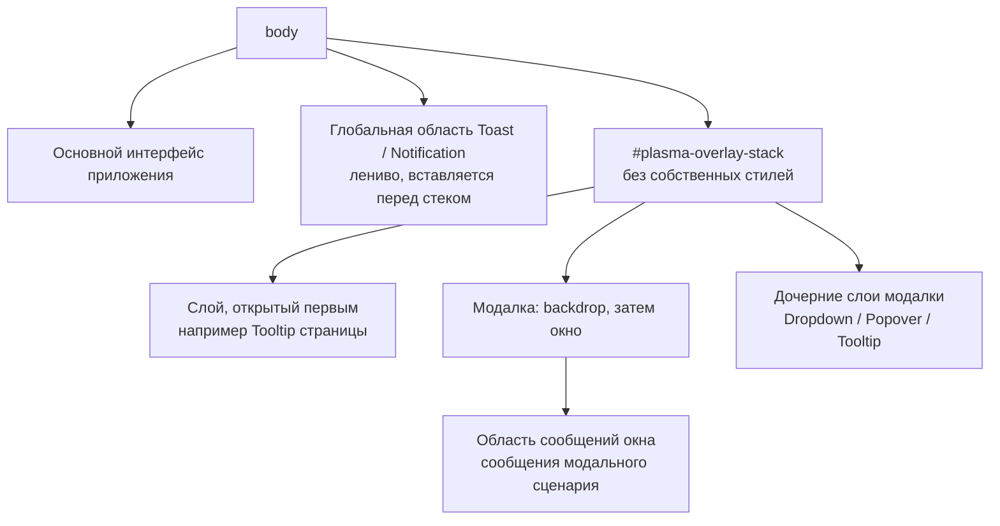

# ADR 0001: Порядок отрисовки и области сообщений бета-оверлеев

-   **Дата фиксации:** 2026-11-27.
-   **Статус:** предложено к принятию через ревью PR.
-   **Область решения:** новые бета-компоненты группы Overlay в `plasma-new-hope` — Modal, Drawer,
    BottomSheet, Popover, Tooltip, Toast, Notification и всплывающие списки (Select, Combobox,
    Dropdown, DatePicker и подобные).

## Контекст

Правила группы Overlay («Правила поведения группы всплывающих компонентов (Overlay)»,
«Overlay: возможности и гарантии SDDS») требуют единого механизма слоёв: компоненты не назначают
произвольный z-index независимо друг от друга, а базовый порядок задан лестницей — основной
интерфейс → немодальные слои → backdrop модального окна → модальное окно → его дочерние слои.

Текущие компоненты таких гарантий не дают: порядок слоёв определяется разрозненными числовыми
z-index, которые каждый компонент назначает самостоятельно —
[9000](../../../Popup/utils/index.ts) у окна и backdrop модалки, [9100](../../../Notification/NotificationsPortal.tsx)
у Notification, [9200](../../../Popover/Popover.tsx) у Tooltip, [9900/9901](../../../Toast/utils.ts)
у Toast, [1000 или ничего](../../../Select/FloatingPopover.tsx) у всплывающих списков. Порталы при
этом собираются тремя разными механизмами (React-портал в узел провайдера, ручной `appendChild`,
`FloatingPortal`), что затрудняет рассуждение о взаимном порядке слоёв.

Обозначенные проблемы группы:

-   **Стекирование.** Toast отображается над backdrop открытой модалки; Dropdown/Select и подобные
    отображаются под любой модалкой; окно и backdrop модалки получают одно и то же значение, и при
    кастомном zIndex взаимный порядок слоёв разных модалок становится неопределённым — окно может
    оказаться под backdrop'ом.
-   **Escape.** Одно нажатие Escape закрывает несколько слоёв сразу; `closeOnEsc={false}` у верхнего
    слоя не защищает нижние. Зафиксировано в [ADR 0002](0002-overlay-registry.md).
-   **Клик вне слоя.** Клик по backdrop модалки может закрыть не связанные нижние слои; содержимое
    порталов не считается «внутри» слоя. Зафиксировано в [ADR 0002](0002-overlay-registry.md).
-   **Блокировка прокрутки.** Конфликты параллельных блокировок; на перемонтированиях теряется
    сохранённый overflow. Зафиксировано в [ADR 0003](0003-overlay-scroll-lock.md).

Эта запись фиксирует решения по стекированию и областям сообщений; реестр (Escape, клик вне,
правила открытия), блокировка прокрутки, фокус, запрос на закрытие и позиционирование
зафиксированы в [ADR 0002](0002-overlay-registry.md) — [ADR 0006](0006-overlay-positioning.md).

## Решение: стекирование

Порядок слоёв определяется порядком появления узлов в DOM, а не числовыми значениями. Все новые
бета-оверлеи рендерятся в один общий контейнер в конце `body`, поэтому правило «открыт позже —
отрисован выше» выполняется без координации значений между компонентами.

1.  **Единый стековый контейнер.** Общий div `#plasma-overlay-stack` в `document.body`, создаётся
    лениво и идемпотентно. Контейнер не имеет собственных стилей: позиционирование и z-index не
    задаются, чтобы не создавать содержащий блок и не влиять на позиционирование fixed-потомков.
2.  **Портал живёт вместе с открытым слоем.** Узел портала появляется при открытии слоя и снимается
    после его закрытия; на время анимации закрытия узел сохраняется, как сейчас делает `usePopup`
    через `isVisible`. Постоянно смонтированный скрытый портал замораживает свою DOM-позицию и
    ломает гарантию порядка.
3.  **Один z-index для всех поверхностей.** Единственная константа (`9000`) применяется к окнам,
    backdrop, поповерам, тултипам и всплывающим спискам. При равных значениях порядок определяет
    DOM. Проп `zIndex` остаётся аварийным люком для продукта, но компоненты больше не строят
    собственных лестниц значений.
4.  **Backdrop и окно — в одном узле, backdrop первым.** Пара рендерится одним порталом, backdrop
    предшествует окну, поэтому окно всегда выше собственного backdrop при любом zIndex. Практика
    уже есть в [popupRoot](../../../Popup/Popup.tsx) — переносим её в новые компоненты как
    обязательную.
5.  **Кастомные контейнеры выводят из стека.** Рендер в `frame`/`portal` покидает общий контейнер;
    порядок таких слоёв определяет продукт.

Лестница из правил воспроизводится автоматически: немодальные слои страницы, открытые до модалки,
стоят в контейнере раньше и оказываются ниже её backdrop; окно выше собственного backdrop; дочерние
слои модалки открываются позже окна и отрисовываются выше него.

### Почему не числовой менеджер слоёв

-   **Динамический z-index-менеджер** (`getTopZIndex() + 1` при открытии) требует централизованной
    бухгалтерии всех слоёв, растит значения и сохраняет модель «побеждает большее число», которую
    правила группы явно запрещают. Порядок отрисовки по-прежнему неочевиден из DOM.
-   **Выправить существующую лестницу констант** (9000/9100/9200/9900) — требует глобального знания
    обо всех слоях при каждом изменении и не защищает ни от кастомных zIndex, ни от смешения с
    легаси-компонентами.
-   **React-провайдер стека с реестром** связывает все компоненты контекстом и требует обернуть
    приложение; контейнер на уровне DOM не требует провайдера и работает для любого сценария
    монтирования. Реестр слоёв ещё понадобится — для Escape, клика вне и фокуса, — но это предмет
    следующих решений; порядок отрисовки он решает избыточно.

## Решение: области сообщений

Область отрисовки сообщения выбирается по месту компонента в дереве React, а не по конфигурации.

1.  **Глобальная область — лениво, перед стеком.** Область сообщений создаётся при первом маунте
    Toast или Notification и вставляется в `body` перед `#plasma-overlay-stack`; если стек ещё не
    создан, область встаёт в конец `body`, а появившийся позже стек окажется после неё. Порядок
    определяет позиция в DOM, а не время создания. Область, как и стек, не имеет собственных
    стилей; повторный маунт компонента заново вычисляет позицию от стека.
2.  **Модальная поверхность предоставляет контекстную область.** Окно модалки рендерит внутри себя
    выделенный узел области сообщений и отдаёт его через обычный React-контекст. Это внутренняя
    деталь компонента, а не app-провайдер: потребитель ничего не оборачивает и не настраивает.
3.  **Toast и Notification порталится в ближайшую контекстную область.** Компонент берёт ближайший
    по дереву контекст области: если он есть — сообщение отрисовывается в области этого окна;
    если нет — в глобальной области.
4.  **Жизненный цикл следует за контекстом.** Узел области модалки снимается вместе с окном —
    сообщение исчезает вместе с модалкой. Сообщение, которое должно пережить модалку, — это
    глобальное сообщение, и монтируется вне модалки.
5.  **Накрытие более поздним слоем — штатно.** Сообщение в контексте модалки отрисовывается выше
    её содержимого; дочерние слои модалки (Dropdown, Popover), открытые позже, отрисовываются выше
    сообщения, а backdrop более поздней модалки накрывает весь контекст вместе с сообщением —
    контекст-предок недоступен, как требует модальность.
6.  **Использование одинаковое во всех контекстах.** `<Toast opened text="…" />` монтируется где
    угодно: вне модалок — глобальное сообщение, внутри детей модалки — сообщение этого сценария.
    Новых пропсов и обёрток не появляется. Это закрывает требования правил («глобальная область
    сообщений не получает автоматически приоритет над модалкой»; сообщение модального сценария
    размещается внутри окна) и гарантии G7.

Пример — один и тот же компонент, место в дереве определяет контекст:

```tsx
// Глобальное сообщение (страница)
<Page>
    <Button onClick={showToast}>Сохранить черновик</Button>
    <Toast opened={toastVisible} text="Черновик сохранён" />
</Page>

// Сообщение модального сценария
<Modal opened={modalOpened}>
    <Button onClick={showToast}>Сохранить</Button>
    <Toast opened={toastVisible} text="Сохранено" />
</Modal>
```

Внутри компонентов (схематично): Modal рендерит область в своём окне и отдаёт её через контекст;
Toast порталится в ближайшую область:

```tsx
// Modal (упрощённо)
<MessagesAreaContext.Provider value={messagesAreaRef}>
    <PopupRoot>
        {children}
        <div ref={messagesAreaRef} /> {/* область сообщений этого окна */}
    </PopupRoot>
</MessagesAreaContext.Provider>;

// Toast (упрощённо)
const scopeRef = useContext(MessagesAreaContext); // null вне модалок

return scopeRef?.current
    ? createPortal(node, scopeRef.current) // контекст модалки
    : createPortal(node, getGlobalMessagesArea()); // глобальная область, перед стеком
```

DOM и порядок отрисовки (все поверхности — `9000`, порядок определяет DOM):

```html
<!-- Тост из модалки: внутри окна, выше содержимого -->
<div id="plasma-overlay-stack">
    <div>
        <!-- модалка A -->
        <div><!-- backdrop --></div>
        <div><!-- окно: контент, затем область сообщений с Toast «Сохранено» --></div>
    </div>
    <div><!-- дочерний Dropdown: выше всего контекста A --></div>
</div>

<!-- Глобальный тост при открытой модалке: перед стеком, ниже backdrop -->
<body>
    <div id="root">…</div>
    <div id="plasma-toast-area"><!-- Toast «Черновик сохранён» --></div>
    <div id="plasma-overlay-stack">…модалка…</div>
</body>
```

### Почему не другие варианты для областей сообщений

-   **Рендер по месту, без портала.** Срабатывает для страницы и модалки, но ломается у предков
    с `transform`/`filter` (fixed начинает позиционироваться относительно них) и попадает в чужие
    stacking context'ы; пропадает единая область для стека нескольких сообщений.
-   **Проп `scope="modal"` или явный выбор области.** Переносит на потребителя знание о контексте,
    которое компонент и так имеет по месту в дереве; конфигурация и положение начинают
    рассинхронизироваться.
-   **Вернуть провайдера сообщений.** Решает ту же задачу координацией сверху, но возвращает
    обёртку приложения, от которой бета-архитектура отказалась.
-   **Поднять глобальную область над модалками (как легаси Toast `9900`).** Противоречит правилам:
    глобальная область не получает автоматически приоритет над модалкой; кроме того, сообщение не
    умирает вместе с модальным контекстом.

## Как разрешаются заявленные случаи

-   Toast не может отрисоваться над backdrop модалки: его область стоит в DOM раньше узлов стека,
    даже если создана позже них.
-   Dropdown/Select, открытые поверх модалки, попадают в контейнер позже неё и отрисовываются выше;
    поповер страницы, открытый до модалки, остаётся ниже её backdrop.
-   Кастомный zIndex больше не ломает пару «окно–backdrop» одной модалки: они в одном узле.
-   Сообщение, вызванное внутри модалки, отрисовывается в её окне, а не скрытым под backdrop.

## Отличия от текущих overlay

| Аспект               | Текущие overlay                                                    | Новые бета-оверлеи                                        |
| -------------------- | ------------------------------------------------------------------ | --------------------------------------------------------- |
| Источник порядка     | числовые z-index, у каждого компонента свои                        | DOM-порядок появления, один z-index                       |
| Механизм портала     | три механизма (портал провайдера, `appendChild`, `FloatingPortal`) | общий контейнер в `body`                                  |
| Окно и backdrop      | одно значение на обоих, порядок держится на DOM внутри узла        | один узел, backdrop первым — гарантировано                |
| Toast/Notification   | fixed в дереве React / отдельный портал с хардкодом значений       | область по контексту: окно модалки или ленивая глобальная |
| Сообщение из модалки | Toast виден поверх всего, включая backdrop                         | внутри окна; умирает с модалкой                           |
| Кастомный zIndex     | может опустить окно под чужой backdrop                             | аварийный люк; пара «окно–backdrop» не ломается           |

## Схема

Пошаговый разбор сценария со снимками DOM — в [примере работы стекирования](0001-overlay-stacking-example.md).



## Ограничения и переходный период

-   Гарантия действует, пока слои рендерятся в общий контейнер в момент открытия. Рендер в постоянно
    смонтированный скрытый портал или в кастомный `frame`/`portal` выводит слой из глобального
    порядка.
-   Контекстную область сообщений предоставляют только модальные поверхности. Немодальный Drawer
    и другие немодальные панели не создают собственного контекста: сообщение внутри них —
    глобальное. Выделенная область определена правилами только для контекстов приложения
    и модального окна.
-   Контекстная область накапливает сообщения своего контекста; лимиты, очередь и позиция области
    внутри окна — детали API и дизайна, документируются отдельно.
-   Легаси-компоненты сохраняют свои константы (9100, 9200, 9900) и продолжают перекрывать
    бета-слои до миграции.
-   Кастомный zIndex остаётся ответственностью продукта: он может поднять слой выше открытых позже.
-   Решение не затрагивает Escape, клик вне слоя, блокировку прокрутки, фокус, правила открытия,
    запрос на закрытие и позиционирование — они зафиксированы в
    [ADR 0002](0002-overlay-registry.md) (реестр: Escape, клик вне, правила открытия),
    [ADR 0003](0003-overlay-scroll-lock.md), [ADR 0004](0004-overlay-focus.md),
    [ADR 0005](0005-overlay-close-request.md) и [ADR 0006](0006-overlay-positioning.md).

Детали API и текущие алгоритмы документируются отдельно.
