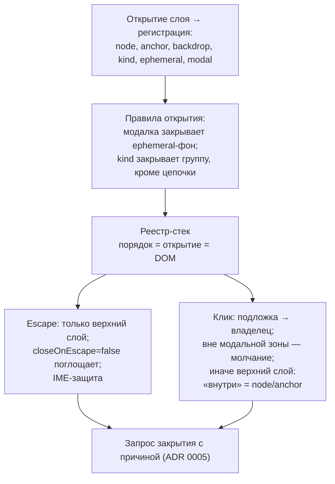

# ADR 0002: Реестр слоёв — Escape, клик вне и правила открытия

-   **Дата фиксации:** 2026-11-27.
-   **Статус:** предложено к принятию через ревью PR.
-   **Область решения:** закрываемые и открываемые слои бета-оверлеев в `plasma-new-hope` — Modal,
    Drawer, BottomSheet, Popover, Tooltip и всплывающие списки (Select, Combobox, Dropdown,
    DatePicker и подобные). Развивает [ADR 0001](0001-overlay-stacking.md): порядок в реестре
    опирается на порядок открытия, совпадающий с порядком отрисовки. Контракт решения о закрытии —
    [ADR 0005](0005-overlay-close-request.md), фокус — [ADR 0004](0004-overlay-focus.md),
    блокировка прокрутки — [ADR 0003](0003-overlay-scroll-lock.md).

## Контекст

Правила группы требуют по этим темам:

-   закрытие обрабатывается сверху вниз по активной цепочке, одно действие пользователя закрывает
    только верхний подходящий компонент и не передаётся дальше (раздел «Закрытие»);
-   обработанный или отклонённый Escape не закрывает предка, отключение Escape у верхнего слоя
    защищает нижние (G2, OV-03);
-   определение «внутри/снаружи» учитывает дочерние слои, в том числе в отдельных контейнерах
    отрисовки; нажатие на блокирующую подложку не активирует фон (G3, OV-04);
-   открытие нового Dropdown или Popover закрывает компонент того же назначения, если они не
    образуют вложенную цепочку; при открытии модального компонента закрываются временные
    Dropdown, Popover и Tooltip фонового интерфейса, включая меню, из которого была запущена
    модалка; постоянно открытые панели сохраняются (раздел «Открытие и правила пересечения»).

Текущие компоненты таких гарантий не дают:

-   каждый немодальный слой вешает собственный слушатель на `window`
    ([Popover.tsx](../../Popover/Popover.tsx)): одно нажатие Escape или один клик закрывает весь
    стек несвязанных слоёв;
-   Escape модалок маршрутизируется реестром провайдера
    ([useModal.ts](../../Modal/hooks/useModal.ts)) — привязка к `PopupProvider`, который
    бета-архитектура не имеет; `closeOnEsc={false}` верхнего слоя не защищает нижние;
-   содержимое порталов не считается «внутри» слоя, якорь портального поповера не учтён — клик
    по триггеру закрывает список до toggle;
-   программные открытия не координируются: второй открытый Select живёт одновременно с первым,
    открытие модалки оставляет временные слои жить под backdrop.

Опыт эталонных библиотек сводится к одному принципу: общий реестр открытых слоёв в порядке
открытия, реагирует верхний слой, его решение финально.

-   **Radix UI** (`DismissableLayer`, проверено по исходникам): слои регистрируются в общем
    контексте, слушатель Escape вешает только верхний (`isHighestLayer`); вето продукта — через
    `preventDefault`; «внутри» — по React-дереву плюс ветки (`Branch`) для якорей портальных
    поповеров; модальность — `body { pointer-events: none }` с послойным включением; подложка
    диалога — «dismissable surface» владельца. Группировку меню Radix решает структурой
    React-дерева.
-   **Floating UI** (`useDismiss`, проверено по исходникам): дерево контекстов `FloatingTree`,
    проверки цели события, флаги-вето дочернего слоя; IME-защита (`isComposing`, keyCode 229,
    WebKit-таймаут).
-   **React Aria**: стек top-layers в `OverlayProvider`, реагирует только верхний (`isTopLayer`).
-   **MUI** (`ModalManager`): модульный синглтон-массив без контекста — доказательство, что
    реестр не требует провайдера.

## Решение

### Реестр-стек

1.  **Модульный реестр открытых слоёв.** Синглтон модуля без React-контекста и провайдера. Слой
    регистрируется при открытии и снимается при закрытии; порядок в реестре равен порядку открытия
    и совпадает с визуальным порядком отрисовки ([ADR 0001](0001-overlay-stacking.md)) — три
    источника истины совпадают без синхронизации.
2.  **Контракт регистрации.** Слой объявляет возможности и зоны:
    `node` — корень портала (узел в стеке), `anchor` — триггер или якорь (для привязанных слоёв;
    компонент знает его из `useFloating`), `backdrop` — блокирующая подложка (для модальных),
    `kind` — группа назначения (`menu`, `popover`, `tooltip`; состав — деталь API компонентов),
    `ephemeral` — временный ли слой, `modal` — модальный ли, `escape` и `outside` — настройки и
    обработчики соответствующих возможностей, `dismiss` — запрос закрытия слою
    ([ADR 0005](0005-overlay-close-request.md)).
3.  **Один слушатель на каждую возможность.** `keydown` для Escape и `pointerdown` (capture) для
    кликов висят на `document`, пока реестр непуст; слушателей на каждый слой и пересчётов
    «верхнего» при открытиях не нужно.
4.  **Toast и Notification не регистрируются** — «не перехватывают Escape глобально» и живут в
    своих областях ([ADR 0001](0001-overlay-stacking.md)).
5.  **Ноль настроек для потребителя.** Поведение включено по умолчанию; `closeOnEsc`,
    `closeOnOutsideClick` и подобные пропсы сохраняют прежний смысл.

### Escape

6.  **Нажатие получает только верхний слой.** Нижние слои не имеют обработчиков — одно нажатие
    закрывает ровно один слой, каскад невозможен по построению.
7.  **`closeOnEscape={false}` верхнего слоя поглощает нажатие.** Нижние слои защищены (G2).
8.  **Решение финально.** Слой передаёт событие пользовательскому колбеку; если оно не отменено
    (`defaultPrevented`) и закрытие разрешено — шлёт запрос закрытия с причиной `escape`
    ([ADR 0005](0005-overlay-close-request.md)). Отклонённое событие к предку не передаётся и не
    повторяется (G2, OV-03, OV-05).
9.  **IME-защита.** Нажатия во время composition-ввода ничего не закрывают (опыт Floating UI,
    включая особенность WebKit).

### Клик вне слоя

10. **«Внутри» — по `composedPath`.** Клик внутренний для слоя, если путь события проходит через
    его `node` или `anchor`; такой клик ничего не закрывает — включая содержимое порталов (G3).
11. **Модальная зона.** Пока есть модальный слой, зона модальности — его подложка, его окно и
    узлы/якоря слоёв, открытых позже него (его дочерние). Клик по подложке — действие над
    владельцем: отвечает только модалка, дочерние слои молчат (OV-04); клик вне зоны — молчание:
    фон недоступен (G1).
12. **Верхний слой решает.** Клик вне `node`/`anchor` верхнего слоя превращается в запрос закрытия
    с причиной `outside` ([ADR 0005](0005-overlay-close-request.md)); нижние слои событие не
    получают.
13. **Одна обработка на нажатие.** Маршрутизатор слушает `pointerdown`, а не `click`; компоненты
    не вешают собственных обработчиков закрытия на подложку — двойные срабатывания исключены.

### Правила открытия и пересечения

14. **Открытие модального слоя закрывает временные слои фона.** При регистрации модального слоя
    закрываются все живые `ephemeral`-слои: к этому моменту они относятся к фону — включая меню,
    из которого была запущена модалка. Постоянные панели (`ephemeral: false`) сохраняются:
    остаются видимыми под backdrop и недоступными.
15. **Открытие временного слоя закрывает предыдущие той же группы назначения.** При регистрации
    слоя с `kind` закрываются живые слои той же группы, кроме предков: предок — живой слой группы,
    в узле которого находится якорь нового (вложенная цепочка, как подменю внутри меню). Якорь
    уже входит в контракт реестра — React-дерево владельцев не требуется.
16. **Закрытие — через запрос.** Реестр вызывает `dismiss` слоя — запрос с причиной
    `intersection` ([ADR 0005](0005-overlay-close-request.md)); идемпотентность обеспечивает
    компонент. Снятие регистрации происходит асинхронно, при перерендере, — правила не зависят
    от мгновенного изменения стека.
17. **Один активный модальный сценарий — следствие стека.** Модальный слой всегда открывается
    поверх: его backdrop накрывает предыдущий контекст, тот сохраняет состояние и становится
    недоступным ([ADR 0001](0001-overlay-stacking.md)); фокус и закрытие обрабатывает верхний
    слой; после закрытия управление возвращается в родительскую
    ([ADR 0004](0004-overlay-focus.md)).

Код реестра и маршрутизаторов (схематично):

```ts
type Layer = {
    node: HTMLElement; // корень портала слоя (узел в стеке)
    anchor?: HTMLElement; // триггер/якорь привязанных слоёв
    backdrop?: HTMLElement; // блокирующая подложка модальных
    kind?: 'menu' | 'popover' | 'tooltip'; // группа назначения
    ephemeral?: boolean; // временный слой
    modal?: boolean; // модальный слой
    escape?: { enabled: boolean; onEscape: (event: KeyboardEvent) => void };
    outside?: { enabled: boolean; onOutsideClick: (event: PointerEvent) => void };
    dismiss: () => void; // запрос закрытия (ADR 0005)
};

const layers: Layer[] = [];
```

```ts
// Escape: реагирует только верхний слой (G2)
const handleKeyDown = (event: KeyboardEvent) => {
    if (event.key !== 'Escape' || event.isComposing || event.keyCode === 229) {
        return;
    }
    const top = layers[layers.length - 1];
    if (top?.escape?.enabled) {
        top.escape.onEscape(event);
    }
    // иначе нажатие поглощается: нижние слои его не получают
};

// Клик вне: модальная зона, затем верхний слой (G3, OV-04)
const handlePointerDown = (event: PointerEvent) => {
    const path = event.composedPath();
    const within = (layer: Layer) => path.includes(layer.node) || (layer.anchor && path.includes(layer.anchor));

    const modal = lastOf(layers.filter((layer) => layer.modal));
    if (modal) {
        if (modal.backdrop && path.includes(modal.backdrop)) {
            // подложка — «кнопка закрытия» владельца: отвечает только модалка
            if (modal.outside?.enabled) {
                modal.outside.onOutsideClick(event);
            }
            return;
        }
        const inZone = path.includes(modal.node) || layersAfter(modal).some(within);
        if (!inZone) {
            return; // клик по фону при модальности (G1)
        }
    }

    const top = lastOf(layers.filter((layer) => layer.outside?.enabled));
    if (!top || within(top)) {
        return; // клик внутри слоя — молчание
    }
    top.outside.onOutsideClick(event);
};

// Правила открытия и пересечения
const registerLayer = (layer: Layer) => {
    if (layer.modal) {
        // временные слои фонового интерфейса закрываются, включая меню-источник
        layers.filter((other) => other.ephemeral).forEach((other) => other.dismiss());
    }
    if (layer.kind) {
        const isAncestor = (other: Layer) =>
            other.kind === layer.kind && layer.anchor && other.node.contains(layer.anchor);
        layers.filter((other) => other.kind === layer.kind && !isAncestor(other)).forEach((other) => other.dismiss());
    }
    layers.push(layer); // новый слой — верх стека
};
```

Слушатели `keydown` и `pointerdown` живут на `document`, пока реестр непуст, и снимаются вместе
с последним слоем.

Поведение на сценариях:

| Сценарий                                          | Результат                                                                             |
| ------------------------------------------------- | ------------------------------------------------------------------------------------- |
| Modal → Popover, нажатие Escape                   | закрывается только Popover                                                            |
| Modal с `closeOnEsc={false}` → Popover, Escape    | ничего не закрывается: нажатие поглощено (G2)                                         |
| Escape во время composition-ввода                 | ничего не закрывается                                                                 |
| Клик по подложке модалки при открытом её Dropdown | закрывается модалка; Dropdown деактивируется владельцем; фон и нижние слои не тронуты |
| Клик по содержимому портального списка            | «внутри» — ничего не закрывается                                                      |
| Клик по триггеру при открытом списке              | реестр молчит (якорь), `click` триггера делает toggle                                 |
| Клик по окну модалки вне списка                   | закрывается список, модалка жива                                                      |
| Клик по странице фона при модалке                 | недостижим: подложка перехватывает; клики вне зоны — молчание (G1)                    |
| Клик по Toast при открытой модалке                | молчание: Toast вне зоны и вне реестра                                                |
| Модалка открыта из пункта меню                    | меню закрывается — «включая меню, из которого была запущена модалка»                  |
| Открыт Dropdown, открывается Select               | Dropdown закрывается: та же группа `menu`                                             |
| Подменю внутри меню                               | живы оба: якорь подменю внутри узла меню — вложенная цепочка                          |
| Открыт немодальный Drawer, открывается Modal      | Drawer сохраняется под backdrop, недоступен                                           |
| Modal A → Dropdown → Modal B                      | Dropdown закрывается: к открытию B он — фон                                           |

### Почему не другие варианты

-   **Слушатель у каждого слоя (текущее поведение).** Одно действие закрывает весь стек; защита
    нижних слоёв требует координации, которой нет; N слушателей и пересчёты «верхнего».
-   **Контекст ветвей и `Branch`-обёртки (Radix).** Результат достижим, но требует общего
    React-контекста и явной регистрации якорей обёртками; у привязанных слоёв якорь уже известен
    компоненту из `useFloating` — передача в реестр решает то же дешевле.
-   **`body { pointer-events: none }` при модальности (Radix).** Глобальный side effect,
    конфликтующий с легаси в переходный период; у нас фон закрыт физически — подложка в
    DOM-порядке выше фона ([ADR 0001](0001-overlay-stacking.md)).
-   **Дерево контекстов с проверкой цели события (Floating UI).** Маршрутизация зависит от того,
    где фокус и куда пришло событие; Escape и клик должны работать и при «сбежавшем» фокусе.
-   **Стек top-layers в провайдере (React Aria).** Возвращает app-провайдера, от которого
    бета-архитектура отказалась.
-   **Полагаться на клик вне для правил пересечения.** Покрывает клик-сценарии, но не программные
    открытия и не открытие модалки: временные слои оставались бы жить под backdrop.
-   **Закрывать все немодальные слои при открытии модалки.** Противоречит правилам: постоянные
    панели сохраняются; признак `ephemeral` разделяет их.
-   **Одна общая группа для всех всплывающих.** Tooltip при открытом Popover не обязан закрываться
    — «того же назначения в той же группе».

### Отличия от текущих overlay

| Аспект                    | Текущие                                              | Новые бета-оверлеи                              |
| ------------------------- | ---------------------------------------------------- | ----------------------------------------------- |
| Источник истины           | слушатели `window` у каждого слоя, реестр провайдера | модульный реестр-стек                           |
| Одно действие             | может закрыть несколько слоёв                        | закрывает один — верхний по возможности         |
| `closeOnEsc={false}`      | не защищает нижние                                   | поглощает нажатие                               |
| Портальные списки         | «снаружи» для своего владельца                       | «внутри» по `node`/`anchor`                     |
| Триггер привязанного слоя | ломает toggle без обёрток                            | якорь в регистрации                             |
| Подложка модалки          | закрывает несвязанные нижние                         | закрывает только владельца                      |
| Группировка               | нет — сосуществуют независимо                        | `kind`-группы, цепочки по якорю                 |
| Открытие модалки          | временные слои живут под backdrop                    | ephemeral закрываются, постоянные сохраняются   |
| IME                       | не учитывается                                       | Escape во время composition ничего не закрывает |

### Схема



## Ограничения и переходный период

-   G5 держится на жизненном цикле: содержимое модалки размонтируется при закрытии, дочерние слои
    снимаются с реестра сами; реестр не дублирует эту работу.
-   `dismiss` — запрос, а не команда: решение о закрытии принимает продукт через
    [ADR 0005](0005-overlay-close-request.md); отклонённый запрос не снимает слой с реестра.
-   Состав групп `kind` — стартовый; точный состав фиксируется в API компонентов.
-   Модальные слои, открытые в разных корнях React (без вложенности), становятся цепочкой:
    нижняя остаётся недоступной под backdrop до закрытия верхней.
-   Прокрутка фона не связана с реестром — [ADR 0003](0003-overlay-scroll-lock.md); фокус-зона
    вычисляется из той же последовательности слоёв — [ADR 0004](0004-overlay-focus.md).
-   Сенсорные устройства покрыты `pointerdown`; в shadow DOM путь события учитывается через
    `composedPath`.
-   Продуктовые обработчики вне SDDS не блокируются: реестр не вызывает `preventDefault` без
    причины.
-   Регистрация снимается при закрытии слоя, не дожидаясь конца анимации: события во время
    анимации закрытия корректно уходят следующему верхнему слою.
-   Легаси-компоненты продолжают работать по-старому; смешанный стек не маршрутизируется совместно.

Детали API и текущие алгоритмы документируются отдельно.
