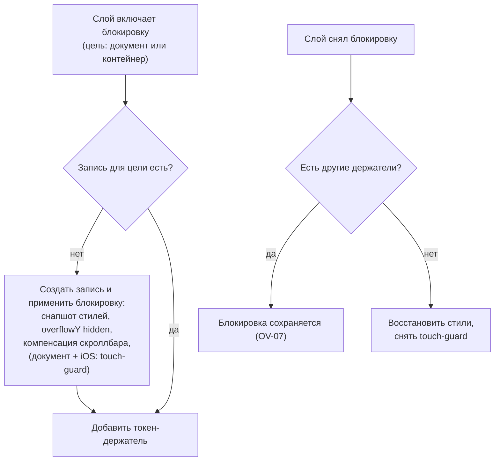

# ADR 0003: Блокировка прокрутки через модульный координатор

-   **Дата фиксации:** 2026-11-27.
-   **Статус:** предложено к принятию через ревью PR.
-   **Область решения:** блокирующие слои бета-оверлеев в `plasma-new-hope` — Modal, модальные
    Drawer и BottomSheet. Развивает [ADR 0001](0001-overlay-stacking.md); ортогонально реестру
    слоёв из [ADR 0002](0002-overlay-registry.md).

## Контекст

Гарантия G6 требует: блокируется прокрутка заданной области — страницы или контейнера; содержимое
Overlay прокручивается независимо, без передачи прокрутки заблокированному фону; блокировка
снимается, когда её больше не удерживает ни один слой; положение фона сохраняется. Проверка OV-07
фиксирует: два слоя блокируют страницу, закрытие по очереди — блокировка держится до последнего
и снимается без скачка позиции.

Текущие компоненты таких гарантий не дают:

-   координация блокировок привязана к провайдерам ([PopupContext.tsx](../../../Popup/PopupContext.tsx)):
    каждый `PopupProvider` независимо регистрируется в модульном наборе, а бета-архитектура
    провайдеров не имеет;
-   стили ставятся на `body.overflowY` без компенсации скроллбара: при блокировке вертикальный
    скроллбар исчезает и страница сдвигается;
-   передача прокрутки фону из содержимого оверлея (scroll chaining) и мобильный скролл фона
    не решены.

Опыт эталонных библиотек сводится к одному каркасу: счётчик активных блокировок, снапшот
и восстановление исходных стилей, компенсация скроллбара только при реальном скроллбаре.

-   **React Aria** (`usePreventScroll`, проверено по исходникам): модульный счётчик, restore при
    нуле. `overflow: hidden` на `documentElement`; компенсация — `scrollbar-gutter: stable`, где
    поддерживается, иначе `padding-right`, и только когда скроллбар реально был. Отдельная
    iOS-ветка: `touchmove` preventDefault вне скроллимых областей, `overscroll-behavior: contain`
    на вложенных скролл-регионах и клавиатурные хаки для фокуса на inputs.
-   **react-remove-scroll** (Radix, проверено по исходникам): перехват `wheel`/`touchmove`
    non-passive на `document` с анализом scroll-цепочек («total gap»), shards, поддержка shadow
    DOM. Стили — в отдельном пакете: `overflow: hidden` на html и body, компенсация
    `padding-right`, `data-scroll-locked`.
-   **MUI** (`ModalManager`): счётчик модалок, `container.overflow = hidden` и
    `padding-right = scrollbarWidth`, восстановление прежних значений.
-   **Ant Design** (`rc-util/ScrollLocker`, проверено по исходникам): массив токенов-держателей,
    идемпотентных по таргету; снапшот стилей по контейнеру; маркер-класс от двойного применения.
    Компенсация — `width: calc(100% - Npx)` и только при реальном скроллбаре (для body —
    `innerWidth - clientWidth > 0`, для контейнера — `scrollHeight > clientHeight`; если контейнер
    уже скрыт — не измерять вовсе).

## Решение

1.  **Модульный координатор-счётчик по целям.** Цель блокировки — документ (по умолчанию) или
    контейнер `frame` (G6: «страницы или контейнера»). Блокировка ставится при переходе 0 → 1
    держателей и снимается при 1 → 0. Держатели — токены, а не булев счётчик: повторные эффекты
    при StrictMode-перемонтированиях идемпотентны, потеря сохранённого overflow исключена.
    Координатор не связан с реестром слоёв: блокировка — не «верхний слой решает», а «держится,
    пока есть хотя бы один держатель», и может понадобиться вне dismissable-слоёв.
2.  **Блокировка документа — на `documentElement`, не на body** (подход React Aria). Легаси
    компоненты трогают `body.overflowY`: разные элементы — независимые снапшоты и восстановления,
    смешанный стек не конфликтует. Ставится только `overflowY` — минимальное вмешательство.
3.  **Компенсация скроллбара без сдвигов.** При первой блокировке измеряется ширина скроллбара
    (`innerWidth - clientWidth` для документа; для контейнера — только если содержимое
    переполняется). Если скроллбар был — `scrollbar-gutter: stable` (одна строка, корректна для
    fixed-элементов), fallback `padding-right: Npx`. Если контейнер уже скрыт — измерение
    не производится (условия Ant Design). Без компенсации каждый показ модалки сдвигал бы
    страницу — тоже «скачок».
4.  **Scroll chaining — декларативно.** Скролл-область контента оверлея имеет
    `overscroll-behavior: contain`: «прокручивается независимо, без передачи прокрутки
    заблокированному фону» (G6) решается CSS без перехватов.
5.  **iOS-перехват — минимальный.** Пока заблокирован документ, `touchmove`-обработчик
    (non-passive, capture) делает `preventDefault`, если цель не находится внутри скроллимого
    элемента (определяется на `touchstart` через scroll-родителя). Клавиатурные хаки React Aria
    (скролл к фокусируемым inputs) не переносятся — это предмет мобильных правил фокуса.
6.  **Использование — ноль настроек.** Модальные слои блокируют по умолчанию, немодальные — нет;
    настройка `scrollLock` открывает исключения. Сценарий OV-07 выполняется счётчиком: блокировка
    держится, пока жив хотя бы один блокирующий слой, и снимается после последнего без скачка.

Код координатора (схематично):

```ts
type ScrollLockEntry = {
    holders: Set<symbol>;
    restore: (() => void) | null;
};

const locks = new Map<HTMLElement, ScrollLockEntry>();

const applyLock = (element: HTMLElement) => {
    const saved = { overflowY: element.style.overflowY, .../* компенсация */ };
    const scrollbarWidth =
        element === document.documentElement
            ? window.innerWidth - document.documentElement.clientWidth
            : element.scrollHeight > element.clientHeight
              ? /* измерение */ 0
              : 0;

    if (scrollbarWidth > 0) {
        if ('scrollbarGutter' in element.style) {
            element.style.scrollbarGutter = 'stable';
        } else {
            element.style.paddingRight = `${scrollbarWidth}px`;
        }
    }
    element.style.overflowY = 'hidden';

    const removeTouchGuard =
        element === document.documentElement && isIOS() ? addTouchGuard() : null;

    return () => {
        element.style.overflowY = saved.overflowY;
        /* откат компенсации */
        removeTouchGuard?.();
    };
};

export const acquireScrollLock = (element: HTMLElement): symbol => {
    let entry = locks.get(element);
    if (!entry) {
        entry = { holders: new Set(), restore: null };
        locks.set(element, entry);
    }
    if (entry.holders.size === 0) {
        entry.restore = applyLock(element);
    }
    const token = Symbol('scroll-lock');
    entry.holders.add(token);
    return token;
};

export const releaseScrollLock = (element: HTMLElement, token: symbol) => {
    const entry = locks.get(element);
    if (!entry || !entry.holders.delete(token)) {
        return;
    }
    if (entry.holders.size === 0) {
        entry.restore?.();
        locks.delete(element);
    }
};

export const useScrollLock = ({ enabled, target = 'document' }) => {
    useEffect(() => {
        if (!enabled) {
            return;
        }
        const element = target === 'document' ? document.documentElement : target;
        const token = acquireScrollLock(element);
        return () => releaseScrollLock(element, token);
    }, [enabled, target]);
};
```

Поведение на сценариях:

| Сценарий                                                 | Результат                                                  |
| -------------------------------------------------------- | ---------------------------------------------------------- |
| Два слоя блокируют страницу, закрытие по очереди (OV-07) | блокировка держится до последнего, снимается без скачка    |
| StrictMode-перемонтирование блокирующего слоя            | токены идемпотентны; стили не теряются                     |
| Продукт сам поставил `overflow` на `html`                | значение сохранено при 0 → 1 и возвращено при 1 → 0        |
| Легаси-модалка (body) и бета-модалка (html) одновременно | независимые элементы — независимые снапшоты                |
| Скролл внутри модалки до края                            | `overscroll-behavior: contain` — фон не прокручивается     |
| Свайп по фону на iPhone                                  | `touchmove` preventDefault вне скроллимых областей         |
| Фиксированный хедер страницы                             | `scrollbar-gutter` компенсирует без сдвига fixed-элементов |

### Почему не другие варианты

-   **react-remove-scroll как зависимость или копия.** Решает больше (shards, pinch-zoom, старые
    iOS через анализ scroll-цепочек по дельтам), но при нашем baseline, где `overscroll-behavior`
    поддержан всеми актуальными браузерами, этот перехват — лишняя сложность.
-   **`position: fixed` + `top: -scrollY`** (старый iOS-трюк). Ломает положение прокрутки
    и `position: sticky` на странице; восстановление позиции дёргает.
-   **Координация через реестр слоёв из ADR 0002.** Смешивает модель «верхний слой решает»
    со счётчиком и связывает блокировку с dismissable-слоями; блокировка может понадобиться
    вне реестра.
-   **CSS-класс без координатора (Bootstrap).** Параллельные блокировки конфликтуют, компенсации
    и восстановления нет.
-   **Компенсация через `width` (Ant Design) или постоянный `padding-right` (MUI).** Меняют
    box-model и пересчитывают проценты потомков; `scrollbar-gutter` свободен от этого.
-   **Стили на body (легаси, Ant Design).** Пересекается с продуктовой логикой и легаси-блокировками;
    `documentElement` разделяет элементы и снимает конфликт переходного периода.

## Отличия от текущих overlay

| Аспект                 | Текущие                       | Новые бета-оверлеи                               |
| ---------------------- | ----------------------------- | ------------------------------------------------ |
| Элемент блокировки     | `body.overflowY`              | `documentElement` (документ) или контейнер       |
| Координация            | Set провайдеров               | модульные токены без провайдера                  |
| Компенсация скроллбара | нет — страница сдвигается     | `scrollbar-gutter` / fallback `padding-right`    |
| Scroll chaining        | не решён                      | `overscroll-behavior: contain` на скролл-области |
| iOS                    | не решён                      | touch-перехват вне скроллимых областей           |
| Потеря overflow        | возможна на перемонтированиях | токены и снапшот исключают                       |

## Схема



## Ограничения и переходный период

-   Скролл к фокусируемым inputs на iOS (экранная клавиатура) не покрывается — предмет мобильных
    правил фокуса, не блокировки прокрутки.
-   Внешние блокировки того же элемента вне координатора не координируются: их значения
    попадут в снапшот и вернутся при снятии, но их снятие может вернуть прокрутку раньше
    времени. Продуктам рекомендуется пользоваться этим же координатором.
-   `overscroll-behavior` на iOS ниже 16 не работает для непереполненных элементов — остаётся
    touch-guard как лучший усилие.
-   Легаси-компоненты продолжают блокировать через `body`; смешанный стек не конфликтует по
    стилям, но iOS-guard легаси не ставит.
-   Детали API и текущие алгоритмы документируются отдельно.
