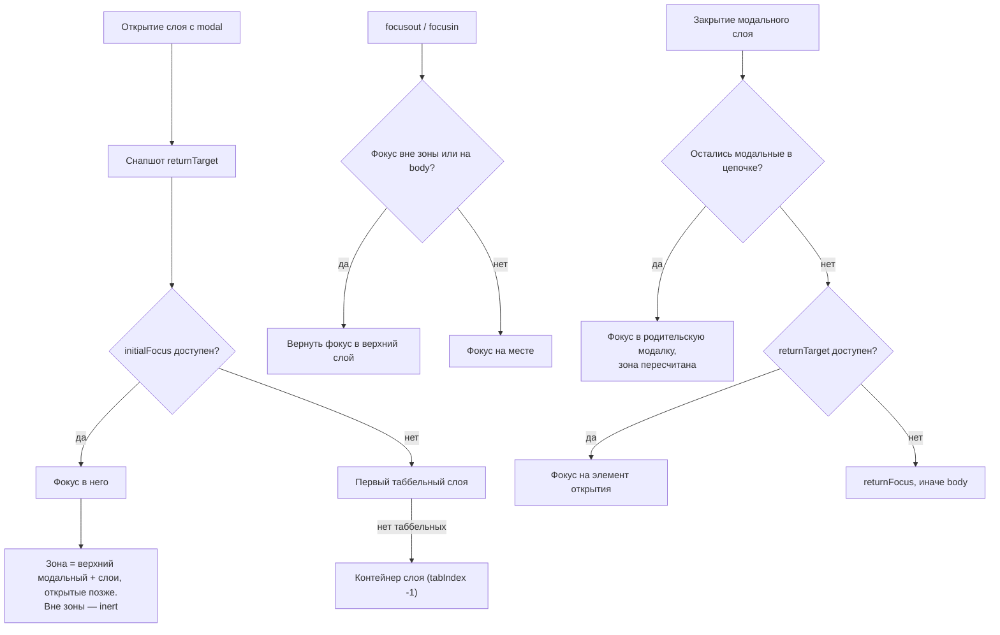

# ADR 0004: Фокус — модальность, начальный и возврат через реестр

-   **Дата фиксации:** 2026-11-27.
-   **Статус:** предложено к принятию через ревью PR.
-   **Область решения:** фокус-поведение слоёв бета-оверлеев в `plasma-new-hope` — Modal, модальные
    Drawer и BottomSheet, Popover и всплывающие списки. Развивает
    [ADR 0002](0002-overlay-registry.md): фокус-зона вычисляется из того же реестра слоёв.

## Контекст

Правила фокуса требуют: при открытии модального компонента фокус перемещается внутрь — на
подходящий элемент, заголовок или начало содержимого; Tab и Shift+Tab перемещают фокус только
внутри модалки и её дочерних Overlay; после закрытия фокус возвращается на элемент открытия,
а если он исчез — на ближайшую логичную точку. Гарантия G1 требует, чтобы фон был недоступен для
взаимодействия и вспомогательных технологий, а фокус был ограничен верхним модальным слоем и его
немодальными потомками. Гарантия G4 требует: цель фокуса должна быть доступной, при её потере
используется резервный переход, а закрытие немодального слоя не отнимает фокус у уже выбранного
пользователем элемента. Проверки OV-01, OV-02 и OV-06 фиксируют Tab-поведение и резервные цели
как кейсы. Модели компонентов уточняют: Modal имеет доступное имя и возвращает фокус после
завершения; Tooltip не получает фокус; Toast и Notification не перемещают фокус.

Текущие компоненты таких гарантий не дают: фокус-поведение живёт в отдельных компонентах
фрагментарно, удержание фокуса внутри модального контекста и гарантированный возврат отсутствуют.

Опыт эталонных библиотек:

-   **Radix UI** (`FocusScope`, проверено по исходникам): Tab-ловушка перехватывает нажатия на
    таб-краях контейнера (обход таббельных элементов через `TreeWalker`), guards на `focusin`/
    `focusout` возвращают «сбежавший» фокус, `MutationObserver` возвращает фокус в контейнер,
    когда сфокусированный узел удалён из DOM; ветки (`branches`) включают порталы поповеров
    в скоуп; вложенные скоупы ставят внешние на паузу; `onMountAutoFocus`/`onUnmountAutoFocus`
    отменяемы через `preventDefault`; при отсутствии таббельных элементов фокусируется сам
    контейнер (`tabIndex={-1}`); фокус ставится через `focus({ preventScroll: true })`.
-   **React Aria** (`ariaHideOutside` + `FocusScope`): всё вне контейнеров оверлея помечается
    `aria-hidden` на уровне потомков `body` (не предков контейнеров), прежние значения атрибутов
    кэшируются и восстанавливаются, вложенные оверлеи совместимы за счёт снапшотов; внутри
    контейнера работает фокус-ловушка.
-   **Атрибут `inert`** — современный стандарт (Chrome 102+, Safari 15.5+, Firefox 112+):
    одновременно убирает поддерево из Tab-порядка и из дерева доступности.

## Решение

1.  **Способность `focus` в реестре слоёв.** Слой при регистрации объявляет:
    `modal` — ограничивать ли фокус своим контекстом, `initialFocus` — явная цель начального
    фокуса (опционально), `returnFocus` — явная цель возврата (опционально). Tooltip и
    Toast/Notification способность не регистрируют — «не получают фокус» и «не перемещают фокус»
    по моделям компонентов.
2.  **Вход.** При открытии слоя с `modal` координатор запоминает `returnTarget` — активный элемент
    на момент открытия. Начальный фокус: `initialFocus`, если задан и доступен; иначе первый
    таббельный элемент слоя (ссылки исключаются); иначе сам контейнер слоя (`tabIndex={-1}`).
    Доступность цели проверяется перед фокусировкой (G4); фокус ставится с `preventScroll`.
3.  **Зона доступности — из реестра.** Зона активного модального контекста: узел верхнего
    модального слоя плюс узлы и якоря всех слоёв, открытых позже него (его дочерние — так же, как
    в [ADR 0002](0002-overlay-registry.md)). Всё вне зоны на уровне потомков `body`
    помечается `inert`. `inert` одновременно исключает фон из Tab-порядка и из дерева
    доступности — Tab-ловушка с перечислением таббельных элементов не нужна, и порталы, и
    динамическое содержимое фона исключаются по построению (G1, OV-01).
4.  **Guard против «сбежавшего» фокуса.** Один документ-уровня обработчик: если активный элемент
    оказался вне зоны (программный фокус, автозаполнение, удаление сфокусированного узла —
    проверяется после `focusout`), фокус возвращается в верхний слой. Отдельный
    `MutationObserver` не требуется.
5.  **Возврат.** Когда закрывается верхний модальный слой и в его цепочке не остаётся других
    модальных, фокус возвращается на `returnTarget`; если он удалён или нефокусируем — на
    `returnFocus`, если задан продуктом; иначе на `body` (G4, OV-06). При закрытии вложенной
    модалки зона пересчитывается: родительская модалка снова становится доступной, и именно в неё
    возвращается фокус — «управление возвращается в родительское» по правилам.
6.  **Немодальные слои не отнимают фокус.** При закрытии немодального слоя фокус возвращается на
    якорь только если в момент закрытия он находился внутри слоя; если пользователь уже переместил
    фокус — он сохраняется (G4, OV-02: Tab наружу остаётся у пользователя).
7.  **Ноль настроек для потребителя.** Поведение включено по умолчанию; `initialFocus` и
    `returnFocus` — опциональные точки кастомизации.

Код координатора (схематично):

```ts
let returnTarget: HTMLElement | null = null;

const markOutsideInert = (zone: HTMLElement[]) => {
    // Потомки body, не являющиеся предками узлов зоны, помечаются inert;
    // прежние значения кэшируются и восстанавливаются при пересчёте зоны.
};

const isFocusable = (element: HTMLElement) => element.checkVisibility?.() && !element.disabled;

const focusInitial = (layer: FocusLayer) => {
    const candidates = [layer.initialFocus, ...getTabbables(layer.node)];
    for (const candidate of candidates) {
        if (candidate && isFocusable(candidate)) {
            candidate.focus({ preventScroll: true });
            return;
        }
    }
    layer.node.focus({ preventScroll: true }); // контейнер с tabIndex={-1}
};

const handleFocusOut = () => {
    setTimeout(() => {
        const top = верхнийСлойСFocus({ modal: true });
        if (!top || document.activeElement !== document.body) {
            return;
        }
        top.node.focus({ preventScroll: true }); // сфокусированный узел удалён из DOM
    }, 0);
};

const handleFocusIn = (event: FocusEvent) => {
    const top = верхнийСлойСFocus({ modal: true });
    if (!top) {
        return;
    }
    const inZone = [top.node, ...nodesAndAnchorsAfter(top)].some((node) =>
        node.contains(event.target as Node),
    );
    if (!inZone) {
        focusInitial(top); // программный фокус или автозаполнение ушло в фон
    }
};

const handleFocusLayerOpen = (layer: FocusLayer) => {
    if (!layer.modal) {
        return;
    }
    returnTarget ??= document.activeElement as HTMLElement;
    focusInitial(layer);
    recalculateInert(); // зона = верхний модальный + всё, открытое позже него
};

const handleFocusLayerClose = (layer: FocusLayer) => {
    if (!layer.modal) {
        return;
    }
    const hasOtherModals = естьМодальныеСлоиКроме(layer);
    if (!hasOtherModals) {
        const target = доступен(returnTarget) ? returnTarget : layer.returnFocus;
        target?.focus({ preventScroll: true });
        returnTarget = null;
    }
    recalculateInert(); // родительская модалка снова доступна
};
```

Поведение на сценариях:

| Сценарий                                            | Результат                                          |
| --------------------------------------------------- | -------------------------------------------------- |
| Открыта модалка, Tab наружу (OV-01)                 | фон `inert` — Tab не покидает контекст             |
| Немодальный Drawer, Tab наружу (OV-02)              | фокус уходит, фон доступен                         |
| `initialFocus` удалён к моменту фокусировки (OV-06) | первый таббельный, затем контейнер                 |
| Сфокусированный узел удалён из DOM                  | guard возвращает фокус в верхний слой              |
| Modal A → Modal B → закрыли B                       | фокус в A, A снова доступна, фон остаётся скрытым  |
| Закрыли последнюю модалку                           | фокус на триггере открытия                         |
| Триггер открытия удалён к моменту закрытия          | `returnFocus`, иначе `body`                        |
| Клик по странице фона на iPhone                     | `inert` блокирует и тач-фокус на фоновых элементах |
| Popover закрыт, фокус пользователя уже вне него     | фокус не тронут (G4)                               |

### Почему не другие варианты

-   **Чистая Tab-ловушка (Radix FocusScope).** Требует перечисления таббельных элементов, отдельной
    обработки порталов (branches), `MutationObserver` и стека пауз для вложенности; фон при этом
    остаётся видимым для вспомогательных технологий без дополнительного маскирования. `inert` по
    реестру решает Tab-порядок и AT одной операцией, а зона уже вычислена реестром.
-   **`aria-hidden` без `inert` (React Aria).** Скрывает фон от вспомогательных технологий, но не
    выводит его из Tab-порядка — ловушка всё равно нужна. `inert` закрывает оба требования.
-   **`MutationObserver` для кейса удаления сфокусированного узла.** Тяжелее проверки активного
    элемента после `focusout`; наблюдатель нужен только там, где нет guard-обработчика.
-   **Стек скоупов с паузами (Radix).** Вложенность и порядок уже определяет реестр; второй стек
    синхронизации не нужен — пересчёт зоны по верхнему модальному слою.
-   **Возврат фокуса всегда (в том числе у немодальных).** Противоречит G4: пользователь, уже
    переместивший фокус, теряет его при закрытии поповера.

## Отличия от текущих overlay

| Аспект            | Текущие                    | Новые бета-оверлеи                               |
| ----------------- | -------------------------- | ------------------------------------------------ |
| Удержание фокуса  | отсутствует / фрагментарно | `inert` вне зоны по реестру                      |
| Начальный фокус   | зависит от компонента      | `initialFocus` → первый таббельный → контейнер   |
| Возврат фокуса    | не гарантирован            | `returnTarget` → `returnFocus` → `body`          |
| Дочерние порталы  | вне скоупа                 | узлы и якоря слоёв зоны                          |
| Вложенные модалки | фокус не маршрутизируется  | закрытие верхней возвращает фокус в родительскую |
| Немодальные слои  | могут отнимать фокус       | возвращают только если фокус был внутри          |

## Схема



## Ограничения и переходный период

-   Решение опирается на атрибут `inert` (Chrome 102+, Safari 15.5+, Firefox 112+); для более
    старых браузеров fallback не предусматривается — это требование к baseline.
-   Программный фокус продукта на фоновые элементы возвращается guard'ом: это требование G1,
    но может удивить сценарии с несколькими независимыми библиотеками на странице.
-   Требование «доступное имя» модалки и клавиатурные модели Menu/Combobox — контракты самих
    компонентов, здесь не фиксируются.
-   Легаси-компоненты продолжают работать по-старому; смешанный стек не координируется.
-   Детали API и текущие алгоритмы документируются отдельно.
