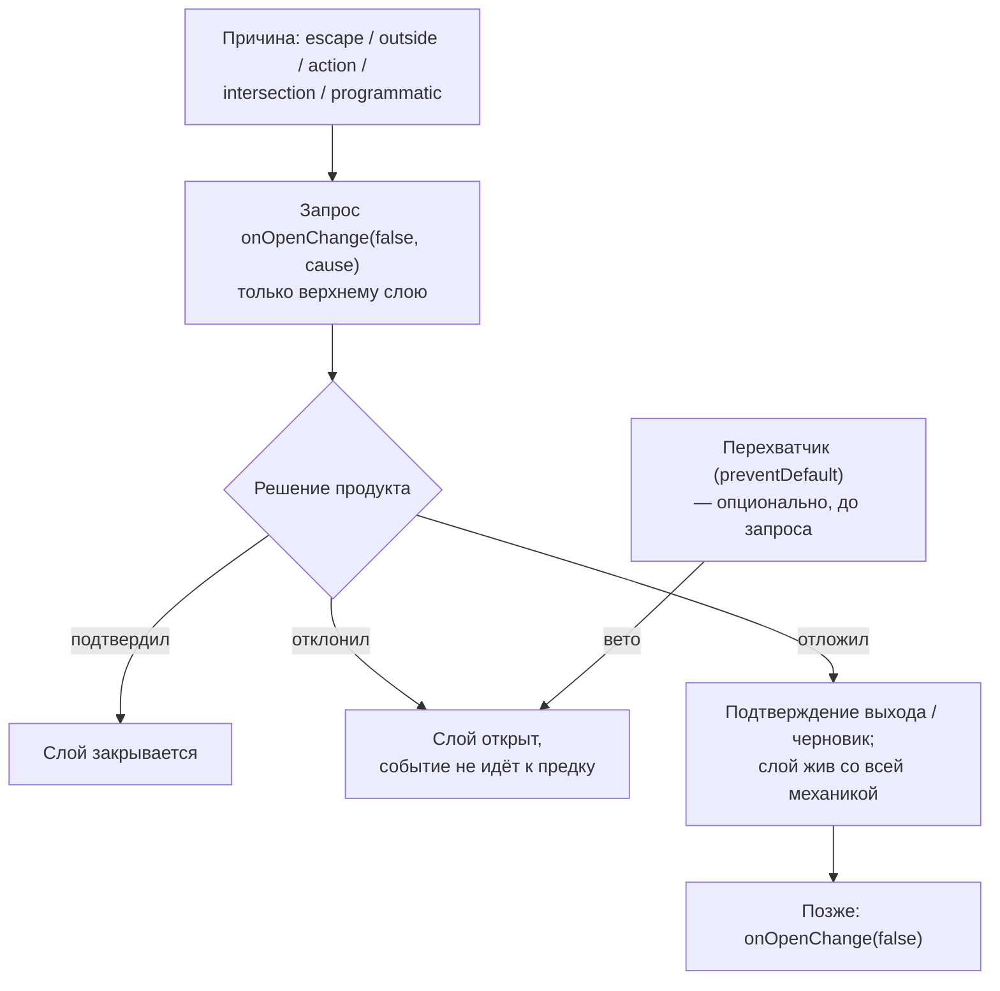

# ADR 0005: Запрос на закрытие с причиной

-   **Дата фиксации:** 2026-11-27.
-   **Статус:** предложено к принятию через ревью PR.
-   **Область решения:** закрытие слоёв бета-оверлеев в `plasma-new-hope` — Modal, Drawer,
    BottomSheet, Popover, Tooltip и всплывающие списки. Развивает
    [ADR 0002](0002-overlay-registry.md): маршрутизация закрытия уже определена, эта запись
    фиксирует контракт самого закрытия.

## Контекст

Раздел «Запрос на закрытие» требует трёх шагов: SDDS сообщает запрос на закрытие и его причину
(Escape, нажатие снаружи или действие внутри слоя); продукт при необходимости подключает проверку —
разрешает, отклоняет или откладывает закрытие, иначе действует стандартное поведение компонента;
SDDS применяет решение — разрешено закрывает слой, отклонено сохраняет его открытым, отложено ждёт
решения владельца. Проверка OV-05 фиксирует: при отклонённом или отложенном запросе слой остаётся
открытым, событие не закрывает предка, SDDS самостоятельно не повторяет исходное внешнее действие.
Правила защиты данных требуют единого правила при несохранённых изменениях: подтверждение выхода,
сохранение черновика или запрет случайного закрытия.

Текущие компоненты дают фрагментарный контракт: колбеки закрытия разрозненны
(`onEscKeyDown`, `onClose`, клик по подложке), причина закрытия не передаётся системно, вето
возможно только синхронно, «отложенное» закрытие не определено.

Опыт эталонных библиотек сводится к трём паттернам:

-   **Полностью контролируемый компонент с причиной** (MUI Dialog): `onClose(event, reason)` —
    запрос, решение целиком у продукта (`open` меняет только он); причина (`escapeKeyDown`,
    `backdropClick`) позволяет выборочно блокировать способы закрытия.
-   **Предотвратимые события плюс контролируемое состояние** (Radix): `onEscapeKeyDown`/
    `onPointerDownOutside` — отменяемые CustomEvent, вето синхронное через `preventDefault`,
    затем `onOpenChange`.
-   **Async-контракт (Ant Design)**: у декларативной модалки отложенное закрытие — `confirmLoading`
    и собственное состояние продукта; у статических методов — `onOk` возвращает Promise
    (resolve — закрыть, reject — нет).

## Решение

1.  **Контролируемая модель: компонент никогда не закрывает себя сам.** Любое событие закрытия
    превращается в запрос — вызов `onOpenChange(false, cause)`. Решение всегда у продукта:
    подтвердил — слой закрывается, не подтвердил — остаётся открытым. Инфраструктуре не нужны
    собственные флаги вето (`closeOnEsc={false}` из [ADR 0002](0002-overlay-registry.md)
    остаётся фильтром на стороне реестра — поглощает нажатие до запроса).
2.  **Причина закрытия — часть запроса.** Стартовые причины: `escape` (Escape, ADR 0002),
    `outside` (нажатие вне или подложка, ADR 0002), `action` (действие внутри слоя — кнопка
    закрытия, выбор пункта), `intersection` (правила пересечения: открытие модалки или нового слоя
    той же группы, ADR 0002), `programmatic` (вызов продукта). Продукт может реагировать
    избирательно, как в MUI: например, игнорировать `outside`, но принимать `escape`.
3.  **Опциональные перехватчики — предотвращаемые события** (паттерн Radix): тонкие кейсы решаются
    до запроса (`onEscapeKeyDown`, `onOutsideClick` — синхронное вето через `preventDefault`,
    доступны события). Базовый сценарий в перехватчиках не нуждается: вето и откладывание делаются
    на уровне `onOpenChange`.
4.  **Отложено — асинхронное решение тем же API.** Продукт не подтверждает запрос немедленно
    (например, показывает подтверждение «Есть несохранённые изменения») и позже подтверждает тем же
    `onOpenChange(false)`. Пока решение не принято, слой живёт со всей своей механикой: блокировка
    прокрутки, зона фокуса, маршрутизация Escape и кликов — состояние консистентно без
    дополнительных действий инфраструктуры. Повторные внешние события порождают новые запросы:
    дедупликация не выполняется.
5.  **Финальность маршрута — гарантия OV-05.** Запрос адресован ровно одному слою — верхнему по
    своей возможности ([ADR 0002](0002-overlay-registry.md)); отклонённый, отложенный или
    обработанный запрос
    не повторяется и к предку не передаётся. Инфраструктура не воспроизводит исходное действие.
6.  **Внутренние действия — тоже запросы.** Кнопка закрытия, выбор пункта меню и подобные действия
    шлют `onOpenChange(false, 'action')`: продукт всегда уведомлён о причинах закрытия, а правило
    «выбор пункта обычно закрывает меню, множественный выбор может оставлять список открытым»
    реализуется тем, шлёт ли компонент запрос.
7.  **Ноль настроек для простых сценариев.** По умолчанию продукт подтверждает запросы — компоненты
    ведут себя стандартно; проверка подключается по мере необходимости.

Код компонента (схематично):

```ts
const requestClose = (cause: CloseCause, event?: Event) => {
    // Опциональный перехватчик: синхронное вето для тонких кейсов.
    if (intercept?.(cause, event)?.defaultPrevented) {
        return;
    }
    // Запрос: решение у продукта.
    onOpenChange?.(false, cause);
};

// Реестр вызывает dismiss() -> requestClose('intersection').
```

Поведение на сценариях:

| Сценарий                                    | Результат                                                    |
| ------------------------------------------- | ------------------------------------------------------------ |
| Escape по форме с несохранёнными данными    | запрос `escape`; продукт показывает подтверждение (отложено) |
| Продукт подтвердил выход                    | `onOpenChange(false)` — слой закрывается                     |
| Продукт отклонил (ничего не сделал)         | слой открыт; предок не получил событие (OV-05)               |
| Клик по подложке при открытом подтверждении | новый запрос `outside` тому же слою                          |
| Отмена подтверждения                        | слой остаётся открытым, механика не деградировала            |
| Выбор пункта меню                           | запрос `action`; множественный выбор — без запроса           |
| Открытие модалки при открытом меню          | запросы `intersection` временным слоям (ADR 0002)            |

### Почему не другие варианты

-   **Promise-контракт в инфраструктуре (`onClose` возвращает Promise, Ant Design Static).**
    Связывает механику закрытия с асинхронностью и требует от инфраструктуры управлять loading-
    состояниями. В контролируемой модели асинхронность естественно живёт у продукта; нуждающимся
    компонентам (подтверждающие окна) контракт возвращается на уровне их API.
-   **Неконтролируемая модель с внутренним состоянием.** Вето и откладывание требуют
    императивных методов и флагов; контролируемая модель даёт их одним правилом «не обновил
    состояние — слой открыт».
-   **Только `preventDefault`-вето без причины.** Продукт не узнаёт, чем закрыли слой: нельзя
    избирательно блокировать способы и логировать причины; MUI-паттерн `reason` снимает вопрос.
-   **Обязательные перехватчики для каждого способа закрытия.** Дублируют `onOpenChange` в простых
    сценариях; перехватчики остаются опциональным точечным инструментом.

## Отличия от текущих overlay

| Аспект                | Текущие                                   | Новые бета-оверлеи                                 |
| --------------------- | ----------------------------------------- | -------------------------------------------------- |
| Кто закрывает слой    | компонент закрывает сам по своим колбекам | компонент шлёт запрос, решает продукт              |
| Причина закрытия      | не передаётся системно                    | `cause` в каждом запросе                           |
| Отложенное закрытие   | не определено                             | асинхронное решение через тот же `onOpenChange`    |
| Вето                  | синхронные флаги/колбеки по компонентам   | не-подтверждение запроса; перехватчики опциональны |
| Повтор события предку | возможен каскад                           | маршрут финален (ADR 0002)                         |

## Схема



## Ограничения и переходный период

-   Повторные внешние события порождают повторные запросы: при открытом подтверждении Escape снова
    придёт к тому же слою — продукт при необходимости фильтрует причины.
-   `closeOnEsc={false}` и аналогичные фильтры реестра поглощают событие до запроса; если продукт
    хочет получать уведомления о поглощённых нажатиях — это перехватчики уровня компонента,
    не реестра.
-   Состав причин (`escape`, `outside`, `action`, `intersection`, `programmatic`) — стартовый;
    расширение (например, `swipe` для BottomSheet) фиксируется в API компонентов.
-   Легаси-компоненты сохраняют прежние контракты до миграции.
-   Детали API и текущие алгоритмы документируются отдельно.
